# RC163-R6 – Prozess-, Navigations- und Quellenreview

Auftrag vom 18.10.2026: Benutzeranmerkungen aus den vier Abschluss-/Exportscreens
umsetzen. Windows/macOS haben denselben fachlichen Ablauf; native Dialoge,
Dateibindung, Corestart und Paketgates behalten ihre eigenen OS-Verträge.
Keine Desktopbedienung, kein Timer, Push, Release oder neuer Macrunner.
R5-Archive, Pakete und alte Fehlbelege bleiben unverändert.

## Ausgangspunkt und Nachweisgrenzen

- R5-Produktstand: `30b4f6a9ecaecb0d29fd1da341191384711f3825ed69e959a67afd67262080bd`.
- Sein zweiter stabiler Headless-Lauf ist beendet: 225/262 bestanden, dann
  `tests/test-companion-ipc.js` rot; 0/8 Zusatzgates. Inputs unverändert.
  `dist/rc163-r5-integrated-final2-20261018/HEADLESS-FINAL.json` ist kein PASS.
- Die Nutzerbilder zeigen den älteren Normalfall `67b68b62…`: 3 Quellen,
  2 Ergebnisse, 1 erwartete OCR-aus-Auslassung, 2 Freigaben und später eine
  abgeschlossene KI-Kopie. Sie sind kein Nachweis des Ein-Datei-OCR-Neustartfalls.
- UML macht Übergänge prüfbar, beweist aber weder tatsächliche OS-Ausführung
  noch Fehlerfreiheit. Die Aktivitätsdiagramme unten sind vereinfachte,
  in Mermaid dargestellte UML-orientierte Abläufe, keine formale UML-XMI-Datei.

## Bestätigte Ist-Probleme

| ID | Ist-Quellenbefund | Soll / Abnahmekriterium |
| --- | --- | --- |
| UI-01 | `showView` markiert für `review`/`documents` weiterhin Verlauf und ändert dessen `aria-controls` | Eigener laufgebundener Bereich; sichtbare Ansicht, aktiver Reiter und dessen Panel stimmen überein |
| UI-02 | Verlauf mischt große Abschlussprosa, Statussummary und weitere Aktionen | Kompakte Karte; Abschluss/Anzahlen sichtbar, lange Details aufklappbar; Ergebnisordner und Hinweise direkt |
| UI-03 | Exportdialog-close schließt ausschließlich das Modal und lässt die Prüfansicht stehen | Nach bestätigtem Abschluss klarer Rückweg zur Übersicht desselben Laufs; kein zweiter Export |
| UI-04 | Diagnose-Speichern wird im erfolgreichen Exportdialog gleichrangig angeboten | Diagnose bleibt jederzeit über Einstellungen/Fehlerhilfe erreichbar, aber kein fachlicher Abschlussschritt |
| UI-05 | Zuordnungen, Dokumentprüfung, Statusabgleich und Kopie sind sprachlich unzureichend getrennt | Vertrauliche Zuordnungen gruppieren; Statusaktualisierung ist Read, keine neue Prüfung; zusätzliche Kopie ausdrücklich optional |
| UI-06 | Navigation und asynchrone Antworten sind über mehrere View-/Originfelder verteilt | Lauf-ID, Viewgeneration und Eigentümer vor jeder Antwort/Navigationswirkung prüfen; keine fremden Entwürfe/ACKs übernehmen |
| QA-01 | R5-Gesamtsuite endet an Companion-IPC | Ursache getrennt bestimmen, gezielt korrigieren/revalidieren, kein pauschales Timeoutverlängern |
| MAC-P3 | Producer-Tooltimeout ist synchron/default-SIGTERM | Begrenzter asynchroner Toollifecycle, ehrlicher Close/Abort; keine native Mac-Ausführung daraus ableiten |

## Gemeinsamer Vertrag: fachlicher Zustand ist nicht die Seite

| Ebene | Beispiele | Was daraus nicht folgt |
| --- | --- | --- |
| Verarbeitung | läuft, pausiert, Prüfung offen, abgeschlossen, abgeschlossen mit Hinweisen, fehlgeschlagen | Kein Export allein durch technischen Abschluss; automatische Erstfreigabe nur im gewählten Schnellweg |
| Dokumentstände | Revision/Hash, ungeprüft, ausdrücklich oder im Schnellweg automatisch freigegeben | Alte Freigabe autorisiert keinen veränderten Textstand |
| Export | nicht beauftragt, Vorschau, läuft, Bestätigung unklar, mit Beleg abgeschlossen | Fehlender optionaler Export macht abgeschlossene Verarbeitung nicht wieder aktiv |
| Navigation | Neue Verarbeitung, Verlauf, Laufdetails mit Übersicht/Prüfung/Dokumenten | Ein Seitenwechsel ist keine Fachentscheidung oder Fortsetzung |
| Unterstützung | Diagnose speichern, technische Ursache ansehen | Keine Freigabe-, Export- oder Laufabschlussautorität |

Ereigniskette jedes Anwendungsfalls: Mensch/Klick → Oberflächenprüfung →
konkreter lokaler Befehl → gebundene Antwort/ACK → passende Ansicht und Fokus.
Fehler/Timeout bedeutet nicht, dass eine Mutation nie stattgefunden hat.
Unsichere Mutationen werden niemals durch Navigation oder Polling wiederholt.

## Klickvertrag für die Abnahme

Dieser Sollvertrag ergänzt die Diagramme. „Laufdetails“ darf nur einen
anzeigenden Kontext auswählen, nicht die mutierende Fortsetzen-Funktion
wiederverwenden. Unbestätigte Daten werden als unbestätigt gezeigt.

| Funktion | Bewusster Auslöser | Wirkung / maßgebliche Bindung | Anschließender sichtbarer Bereich |
| --- | --- | --- | --- |
| 01 Auswahl | Dateien/Ordner auswählen, Ordner ändern | Native Auswahl, Katalogrevision und opake Quellen-IDs; Abbruch bewahrt bisherigen Kontext | Neue Verarbeitung |
| 02 Markdown | Verarbeitung starten | Ein Start mit `markdown-only`, Inhalts-/OCR-Optionen und genau dem zugelassenen Katalog | Laufdetails der bestätigten `batch_id` |
| 03 Geführte Anonymisierung | Verarbeitung starten; später Jetzt prüfen | Ein Start mit `markdown-and-anonymize`; Prüfung nur mit passender nativer Reviewgeneration | Laufdetails, gegebenenfalls eingebettete Prüfung |
| 04 Schnellweg | Schnellweg wählen und starten | Automatische Erstfreigabe innerhalb derselben Policy, keine Abschaltung der Integritäts-/Restprüfungen | Laufdetails mit automatischem Prüfhinweis |
| 05 Fundstellen | Vormerken; separat Speichern / Später entscheiden | Lokal vorgemerkt ist nicht gespeichert. `submit_review` bindet Review-ID; späteres `continue_review_session` ist eine gesonderte bewusste Fortsetzung | Prüfung, nächste Gruppe oder vertagte Laufübersicht |
| 06 Dokumente | Dateiname; anschließend Auswahl freigeben / Änderung speichern | Detailread bindet Dokument-ID, Revision und Hash; Mutation braucht deren aktuellen Nachweis und ACK | Dokumentansicht im selben Laufdetails-Bereich |
| 07 Export | Vorschau; anschließend Exportieren | Plan allein kopiert nicht. Kopie und dauerhafter ACK verwenden dieselbe Operation-ID und Auswahl | Erfolg; nach Schließen Übersicht derselben Lauf-ID |
| 08 Verlauf | Verlauf / Laufdetails / Status aktualisieren | Normale Reads starten weder Lauf noch Export. Nur ausdrücklich zielgebundene Bereitstellungs-Recovery kann nachholen | Liste oder gewählte Laufübersicht; nie eine fremde aktuelle Batch |
| 09 Vertagen/Neustart | Später entscheiden / Pause / später Fortsetzen | Deferred-ACK bzw. tatsächliche ruhige Pause abwarten. Appstart übernimmt keine ungespeicherten Vormerkungen und wiederholt keine Mutation | Offen/pausiert im Verlauf, Fortsetzung nur ausdrücklich |
| 10 Unterstützung | Diagnosepaket speichern | Native lokale Diagnose ohne Core; unabhängig von Fachabschluss, kein Upload | Herkunft bleibt, Diagnoseergebnis separat |
| 11 Verbindung | Appstart / Verbindung und Laufstatus prüfen | Prozess-/Connectiongeneration und bestätigtes altes Prozessende; keine endlose Wiederholung | Bereite Auswahl oder konkrete Fehlerhilfe |

### Status und Folgeaktionen

| Belegter Zustand | Sichtbare Hauptaussage | Naheliegende Aktion | Kein Pflichtschritt |
| --- | --- | --- | --- |
| Aktiv | Verarbeitung läuft | Laufdetails / Pause, falls zulässig | Keine erneute Startaktion |
| Vertagt oder ruhig pausiert | Prüfung offen / pausiert | Denselben Lauf ausdrücklich fortsetzen | Kein Neustart der ganzen Verarbeitung |
| Verarbeitung beendet, Ergebnisse vorhanden | Lauf abgeschlossen, gegebenenfalls mit Hinweisen | Ergebnisordner; für einen gewünschten Export Dokumente prüfen | Export und Diagnose sind freiwillig |
| Alle verfügbaren Dokumentstände freigegeben | Verarbeitung abgeschlossen; Freigaben vorhanden | Gewünschten Export vorschauen | Fehlender Export ist kein Laufabbruch |
| Export dauerhaft bestätigt | Export abgeschlossen; tatsächlich kopierter Umfang | Exportordner öffnen / Übersicht | Kein erneutes Freigeben oder Exportieren desselben Stands |
| Erwartete OCR-aus-Auslassung | Abgeschlossen mit Hinweisen; ausgeschlossene Dateien zählen | Hinweise ansehen; neuer OCR-Lauf nur bei Bedarf | Auslassung ist kein technischer Konvertierungsfehler |
| Technischer Teilfehler oder Datenschutzstopp | Teilumfang und konkrete Gründe, kein pauschaler Gesamterfolg | Betroffene Dateien / Hilfe | Vorhandene Ergebnisse sind nicht der Beleg für alle Quellen |
| ACK oder heutiger Status unklar | Abschluss/Stand noch nicht bestätigt | Zielgebunden abgleichen | Weder blind erneut exportieren noch alten Erfolg überschreiben |

## 01 – Aufgabe, Ergebnisordner und Eingaben wählen

Produktquellen: `workspace.js` – `configure`, `pick`, `applyContext`,
`renderTree`, `updateStart`; native Picker-/Namespaceprüfung unverändert.

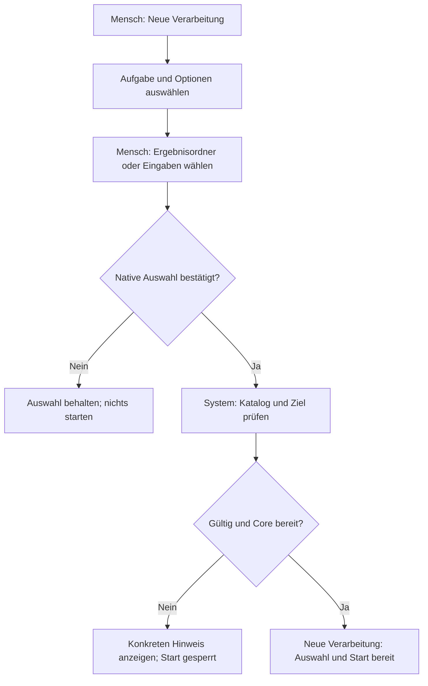

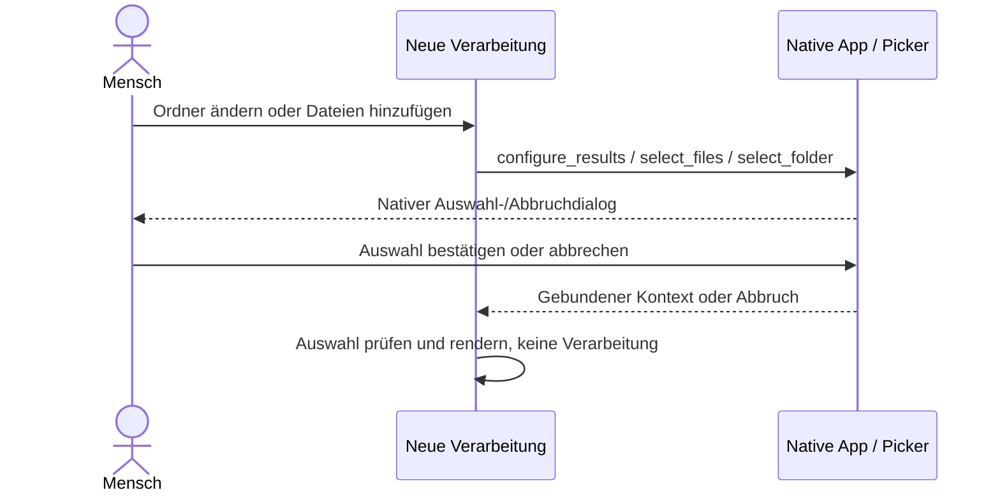

## 02 – Nur in Markdown umwandeln

Produktquellen: `workspace.js` – `start`, `renderJob`; `conversionSummary`.
Nachkorrektur und zusätzliche Kopien sind kein Pflichtabschluss.

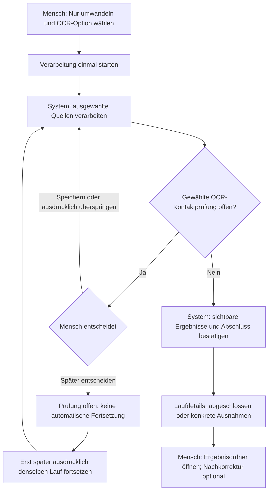

```mermaid
sequenceDiagram
  actor Mensch
  participant UI as Oberfläche
  participant App as Lokale App / Core
  Mensch->>UI: Verarbeitung starten
  UI->>App: start_admitted_batch mit markdown-only und Inhaltsoptionen
  App-->>UI: Bestätigte batch_id
  UI->>App: get_public_state
  App-->>UI: Fortschritt, Prüfung oder bestätigter Abschluss
  UI-->>Mensch: Laufdetails derselben ID; Rohinhalt nicht anonymisiert
```

## 03 – Geführte Anonymisierung

Produktquellen: `start`, `renderJob`, `beginReview`, `openDocuments`;
Backend verarbeitet nur zugelassene/gebundene Quellen.

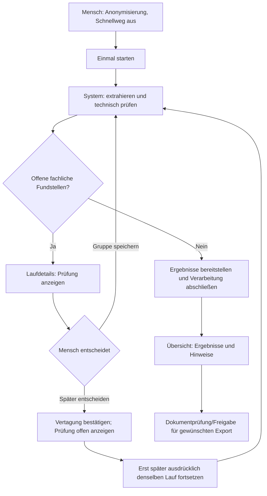

```mermaid
sequenceDiagram
  actor Mensch
  participant UI as Oberfläche
  participant App as Lokale App / Core
  Mensch->>UI: Geführten Lauf starten
  UI->>App: start_admitted_batch mit markdown-and-anonymize
  App-->>UI: batch_id und spätere Zustände
  opt Fachliche Entscheidung erforderlich
    Mensch->>UI: Jetzt prüfen
    UI->>App: continue_history_batch und open_embedded_review
    App-->>UI: Gebundene Reviewgeneration
    UI-->>Mensch: Prüfung im Laufdetails-Bereich
  end
  App-->>UI: Verarbeitung abgeschlossen, Ergebnisse/Hinweise
  UI-->>Mensch: Übersicht; keinen Export automatisch erstellen
```

## 04 – Schnellweg-Anonymisierung

Produktquellen: `start`/`reviewPolicy`, automatische Backendprüfung,
`document-review.js`/`automatic`; kein Entfernen technischer Gates.

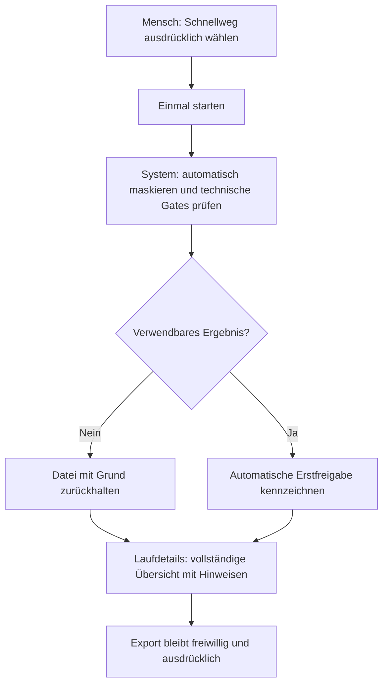

```mermaid
sequenceDiagram
  actor Mensch
  participant UI as Oberfläche
  participant App as Lokale App / Core
  Mensch->>UI: Schnellweg wählen und starten
  UI->>App: start_admitted_batch mit automatic-conservative
  App->>App: Maskierung, Rest-/Integritätsprüfung, Bereitstellung
  App-->>UI: Ergebnisse, Ausnahmen und automatische Erstfreigabe
  UI-->>Mensch: Abgeschlossen; automatisch, nicht manuell geprüft
  Note over Mensch,App: Kein Export allein durch Abschluss oder Seitenwechsel
```

## 05 – OCR-/Fundstellenprüfung und gleiche Lesarten

Produktquellen: `review.js` – Vormerkung, `sendAnswer`, Kopiervorschlag;
Workspace-Reviewfassade prüft Sitzung, Generation und natives ACK.

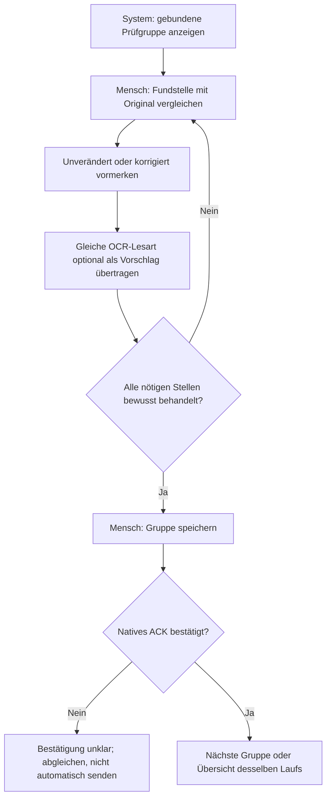

```mermaid
sequenceDiagram
  actor Mensch
  participant Review as Prüfansicht
  participant App as Native Review / Core
  Review->>App: get_review_session und get_review_chunk
  App-->>Review: Sitzung und zugehörige Fundstellen
  Mensch->>Review: Vormerken oder gleichen Vorschlag einsetzen
  Note over Mensch,Review: Noch keine gespeicherte Entscheidung
  Mensch->>Review: Entscheidungen speichern und fortfahren
  Review->>App: submit_review mit vollständiger Gruppe
  App-->>Review: accepted oder unklare/abgelehnte Bestätigung
  Review->>App: Nur Status der gleichen Sitzung abfragen
  opt Nächster Schritt erfordert bewusste Fortsetzung
    App-->>Review: continuation_available für dieselbe Sitzung
    Mensch->>Review: Nächsten Prüfschritt starten
    Review->>App: continue_review_session
    App-->>Review: Annahme; anschließend Status derselben Sitzung lesen
  end
  Review-->>Mensch: Folgegruppe, Übersicht oder klarer Fehler
```

## 06 – Dokumente vergleichen, ändern und freigeben

Produktquellen: `document-review.js` – `loadDetail`, `decideRows`,
`decideSelection`, Textänderungsbestätigung, Dirty-/Revision-/Hashschutz.

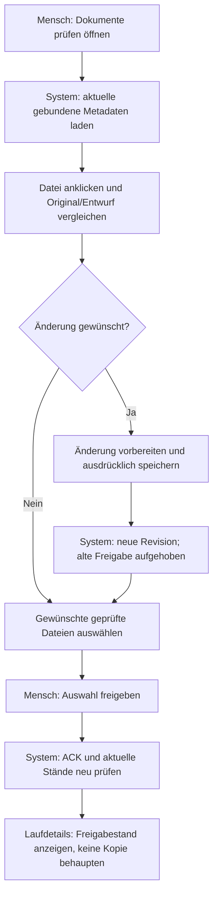

```mermaid
sequenceDiagram
  actor Mensch
  participant UI as Dokumentansicht
  participant App as Lokale App / Core
  UI->>App: get_document_reviews
  Mensch->>UI: Dateiname anklicken
  UI->>App: get_document_review_chunk mit exakter Bindung
  App-->>UI: Original und aktueller Textstand
  Mensch->>UI: Auswahl freigeben oder Änderung bestätigen
  UI->>App: decide_document_review / decide_document_review_batch
  App-->>UI: Bestätigte Entscheidung für Revision und Hash
  UI->>App: Aktuellen Stand nachladen
  UI-->>Mensch: Freigabe anzeigen; kein automatischer Export
```

## 07 – Optionaler Export und bestätigter Abschluss

Produktquellen: `openExportDialog`, `exportSelected`, Exportbelege;
vorhandene operationId-/ACK-/Scopeprüfungen erhalten.

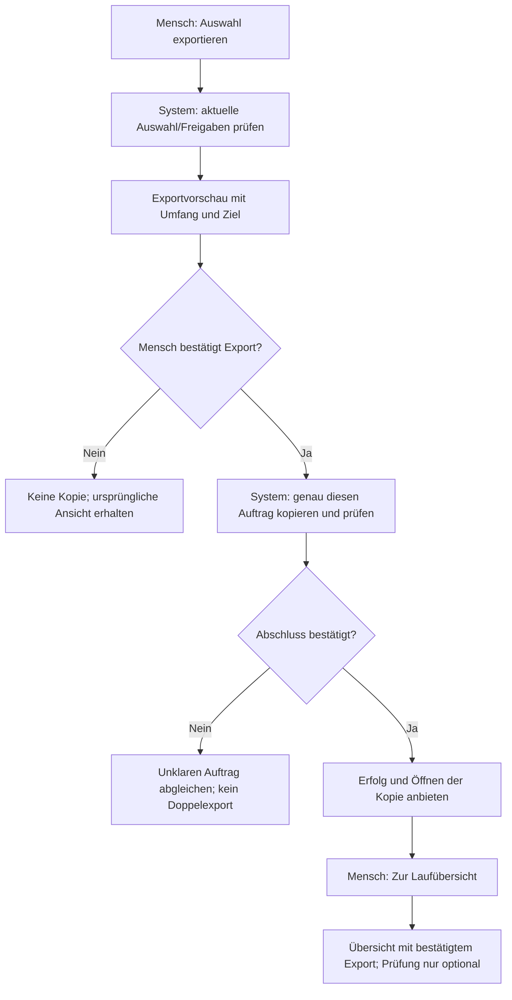

```mermaid
sequenceDiagram
  actor Mensch
  participant UI as Laufdetails / Exportdialog
  participant App as Lokale App / nativer Export
  Mensch->>UI: Auswahl exportieren
  UI->>App: preview_document_export mit Revision/Hash
  App-->>UI: Geprüfter Plan, noch keine Kopie
  Mensch->>UI: Exportieren
  UI->>App: export_approved_documents mit genau einer operationId
  App-->>UI: Auftrag/Abschluss für diese Auswahl
  UI->>App: export_approved_documents mit derselben operationId, Auswahl und acknowledge true
  App-->>UI: Bestätigter Abschlussbeleg
  UI-->>Mensch: Erfolg; Diagnose ist kein Pflichtschritt
  Mensch->>UI: Zur Laufübersicht
  UI-->>Mensch: Übersicht derselben batch_id, Laufdetails aktiv
```

## 08 – Verlauf, Laufdetails, Ergebnisordner und Zuordnungen

Produktquellen: `refreshHistory`, `historySummary`, `problems`, native
`open_history_*`-Befehle. Keine vollständigen Dateitexte beim Appstart laden.

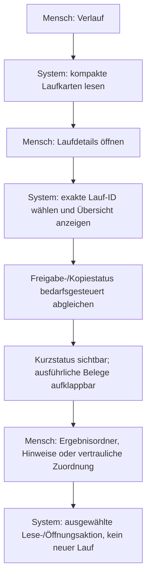

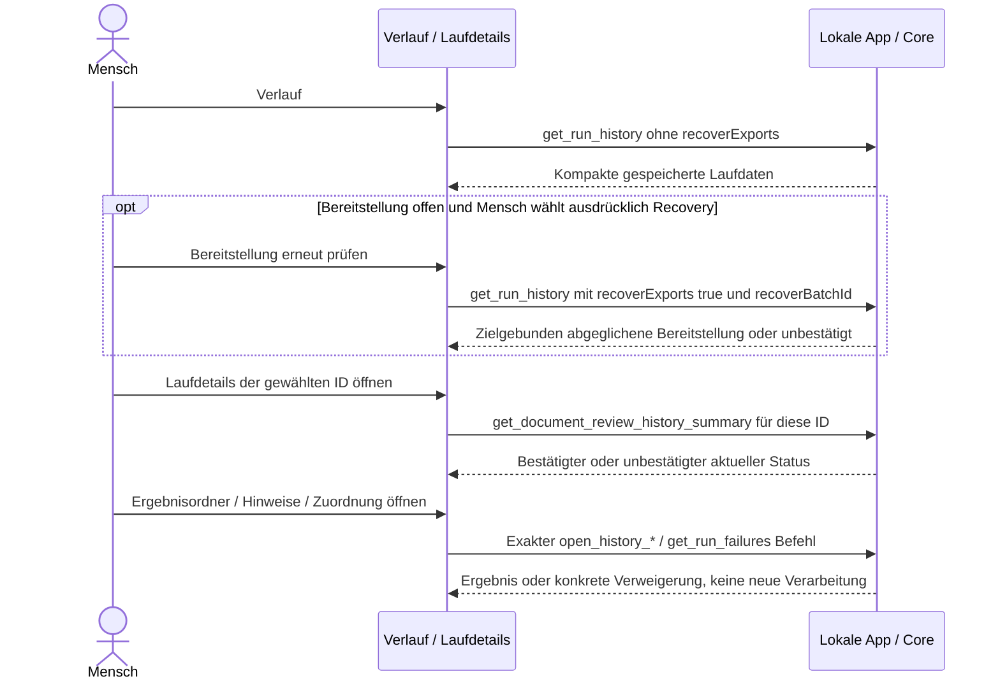

## 09 – Vertagen, Pause und Neustart

Produktquellen: `review.js`/defer, Workspace-Reviewfassade, `pause_batch`,
`resumeRun`, `continue_history_batch`. Vorbereitet ist nicht gespeichert.

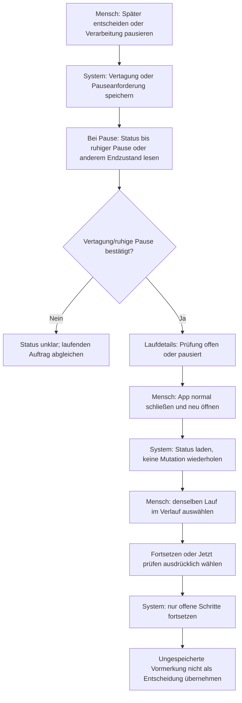

```mermaid
sequenceDiagram
  actor Mensch
  participant UI as Oberfläche
  participant App as Lokale App / Core
  Mensch->>UI: Später entscheiden oder Pausieren
  UI->>App: submit_review deferred oder pause_batch
  App-->>UI: Gebundenes Deferred-ACK oder gespeicherte Pauseanforderung
  opt Pause angefordert und noch nicht ruhig
    UI->>App: get_public_state, nur Statuspoll
    App-->>UI: Tatsächlich pausiert oder anderer belegter Zustand
  end
  UI-->>Mensch: Tatsächlichen Status anzeigen; Pauseannahme allein ist kein ruhiges Ende
  Mensch->>UI: App schließen und erneut starten
  UI->>App: Nur Kontext und Status lesen
  Mensch->>UI: Selbe batch_id ausdrücklich fortsetzen
  UI->>App: continue_history_batch
  App-->>UI: Offene Schritte / gebundene Prüfung
  UI-->>Mensch: Laufdetails; alte ungespeicherte Eingaben nicht als bestätigt
```

## 10 – Diagnose speichern

Produktquellen: Workspace `saveDiagnosticBundle`; nativer Befehl ist bewusst
ohne laufenden Sidecar erreichbar. Nicht auf erfolgreiche Läufe beschränken.

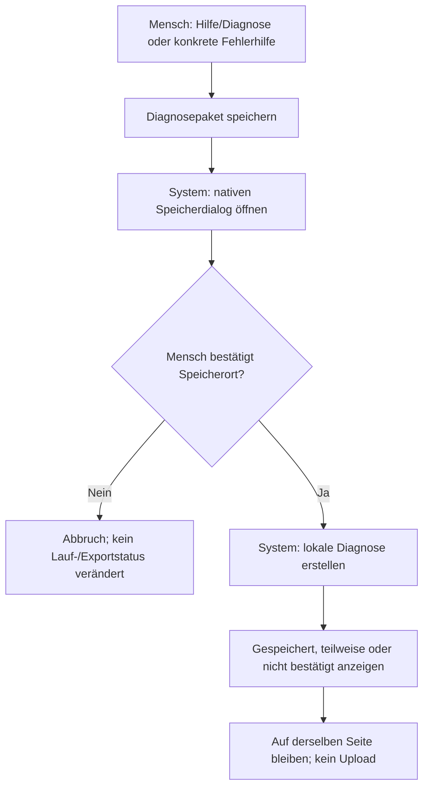

```mermaid
sequenceDiagram
  actor Mensch
  participant UI as Hilfe / Fehleranzeige
  participant Native as Native App, ohne Core erforderlich
  Mensch->>UI: Diagnosepaket speichern
  UI->>Native: save_diagnostic_bundle
  Native-->>Mensch: Speicherdialog
  Mensch->>Native: Bestätigen oder abbrechen
  Native-->>UI: saved / partial / cancelled oder unbestätigt
  UI-->>Mensch: Supportergebnis; unveränderter fachlicher Laufstatus
```

## 11 – Appstart und Verbindungsfehler

Produktquellen: Workspace `bootstrap`, `refresh`, native Recoveryreceipt und
Rust-Prozesslebenszyklus. Kein Erfordernis, einen alten Lauf erneut zu starten.

```mermaid
flowchart TD
  A["Mensch: App öffnen"] --> B["System: Core, Kontext und Bereitschaft prüfen"]
  B --> C{"Bereitschaft bestätigt?"}
  C -- Ja --> D["Neue Verarbeitung bereit; Verlauf erst bei Bedarf"]
  C -- Nein --> E["Konkrete Ursache und Diagnosehilfe; kein Endlosretry"]
  E --> F["Mensch: Verbindung und Laufstatus prüfen"]
  F --> G["System: altes Prozessende/Recovery prüfen"]
  G --> H{"Sicherer neuer Status verfügbar?"}
  H -- Ja --> D
  H -- Nein --> E
```

```mermaid
sequenceDiagram
  actor Mensch
  participant UI as Oberfläche
  participant Native as Rust / lokaler Core
  Mensch->>UI: App starten
  UI->>Native: frontend_ready und get_public_state / get_ui_context
  Native-->>UI: Bestätigte Bereitschaft oder feste Ursache
  alt Fehler
    UI-->>Mensch: Ursache und Diagnosehilfe, Auswahl gesperrt
    Mensch->>UI: Status ausdrücklich erneut prüfen
    UI->>Native: Gebundene Recovery-/Statusabfrage
    Native-->>UI: Sichere Auflösung oder fortbestehender Fehler
  else Bereit
    UI-->>Mensch: Neue Verarbeitung; kein automatisches altes Fachkommando
  end
```

## Verbindliche Gegenproben der Umsetzung

Die eingesetzten Architektur-, Rust-/OS- und Usability-Expertenrollen sind
spezialisierte KI-Reviewaufträge. Die Gegenproben sind unabhängig formuliert,
aber weder eine menschliche Zertifizierung noch ein Ersatz realer Zielhosts.

1. Jeder sichtbare Reiter besitzt ein eindeutiges Panel; keine Umwidmung des
   Verlauf-Reiters auf Dokument-/Reviewinhalt. Tastatur/Fokus und kleine Fenster.
2. Laufwechsel während verzögertem Close/Read/Export-ACK verändert nicht die
   falsche Übersicht. Dirty-/Busy-/Review-Schutz bleibt vor jeder Navigation.
3. Einklappen und Statusaktualisierung sind ausschließlich Darstellung/Reads;
   kein `continue_*`, Entscheidungs- oder Exportkommando ohne bewusste Aktion.
4. Vorschauabbruch erstellt keine Kopie; bestätigter Abschluss erzeugt keine
   zweite Freigabe/Kopie. Unbestätigtes ACK bleibt unbestätigt.
5. Abschluss mit erwarteter OCR-Auslassung bleibt abgeschlossen mit Hinweis;
   fehlender freiwilliger Export ist kein fehlgeschlagener Lauf.
6. Diagnose erreichbar bei Coreausfall; Diagnosefehler überschreibt weder
   Laufabschluss noch Verbindungslage. Zuordnungen vertraulich gekennzeichnet.
7. Exaktes Quellen-/Paketbinding nach Änderungen neu prüfen; alter R5-Binärstand
   verändert sich nicht automatisch. Kein Mac-Abnahmeclaim aus Windowsmodellen.

## Fachquellen

- [W3C: Tabs und zugehörige Panels](https://www.w3.org/WAI/ARIA/apg/patterns/tabs/).
- [GOV.UK: Details nicht für allgemein benötigte Informationen](https://design-system.service.gov.uk/components/details/).
- [Microsoft: häufig benötigte Aktionen direkt erreichbar](https://learn.microsoft.com/en-us/windows/apps/develop/ui/controls/menus-and-context-menus).
- [Node22: synchrone Timeout-/Closegrenzen](https://nodejs.org/download/release/v22.23.2/docs/api/child_process.html#child_processexecfilesyncfile-args-options).
- [GOV.UK: Abschluss mit Referenz und verständlichen Folgeaktionen](https://design-system.service.gov.uk/patterns/confirmation-pages/).

## Gegenreview der Diagramme

Ein zweiter Quellenreview hat fünf Vereinfachungsfehler im ersten Entwurf
gefunden. Sie sind oben korrigiert: Vertagen endet im offenen Zustand statt
automatisch fortzusetzen; `continuation_available` kann einen bewussten
weiteren mutierenden Schritt benötigen; Pauseannahme ist keine ruhige Pause;
Export-ACK ist ein eigener zielgebundener persistierender Aufruf; normale
Verlaufsreads sind von ausdrücklich beauftragter Bereitstellungs-Recovery
getrennt. Diese Korrekturen sind Dokumentationsbefunde, keine fünf neu
bewiesenen Produktfehler. Die betreffenden Produktionsstellen wurden danach
auch vom Hauptagenten direkt nachgelesen.

## Laufender Quellengegenreview der Umsetzung

- UI-06-Gegenfall: Zwei schnelle Reiterwechsel während des ausstehenden
  nativen Dokument-Close können einen inzwischen geleerten Dokumentbereich
  zurücklassen. Der tatsächliche neue `showView`-Body wurde mit dem echten
  Close-Vertrag modelliert: Das Renderermodul leert seine Batch-ID synchron,
  bevor sein natives Close-Await endet. Verlauf → Einstellungen erfasste beim
  zweiten Klick dadurch einen Null-Owner, der nicht mehr zum alten Guide
  passte. Erste Probe rot; Nachweis unter
  `dist/rc163-r6-nav-close-race-20261018/BEFORE.json`. Dies ist ein Gegenfall
  des entstehenden Deltas, kein bewiesener Fehler des eingefrorenen R5-Pakets.
  Ein gemeinsamer Closeauftrag mit festem Owner und letzter Zielnavigation
  behebt den Gegenfall. Die tatsächlichen Renderermodule bestehen danach
  die verzögerte Doppelwechsel-Gegenprobe; BEFORE/AFTER bleiben getrennt.
- Die Anleitungsprüfung schrieb den alten gleichrangigen Diagnosebutton im
  Exportdialog fest. Nach Abgleich mit der neuen Supporteinordnung wurde
  dieser enge Präsentationsvertrag migriert: Einstellungen/Fehlerhilfe,
  Diagnose ohne Core und ausdrücklich kein notwendiger Exportabschluss.
  Gleichzeitig sind die drei Navigationsbereiche und der Rückweg zur
  Übersicht desselben Laufs verpflichtend geprüft. 28 Dokumentationsfälle
  danach grün; keine Sicherheitsprüfung oder fachliche Freigabe entfernt.

## Weitere unabhängig bestätigte und behobene Übergabefehler

- Das neue „Exportordner öffnen“ nach Dokument-Close benötigte zunächst noch
  dessen inzwischen korrekt gelöschte native Dokumentbindung. Der neue
  `open_recorded_document_export` erhält ausschließlich Batch-/Operations-ID,
  Hauptfenster und Eingangs-Verbindungsepoche. Er prüft den vorhandenen
  Abschlussbeleg, die gespeicherten Verzeichnisidentitäten und sämtliche
  Dateihashes erneut; nach Await prüft er Epoche und Shutdown vor OS-Handoff.
  Kein Renderer-Pfad, kein Wiederherstellen einer Dokumentfreigabe und keine
  neue Kopie/Empfangsbestätigung. Der bestehende Resolver darf fehlende
  Abschlussmetadaten einer früheren Veröffentlichung abgleichen; „nur lesend“
  ist daher kein Versprechen vollständig schreibfreier Dateisystemzugriffe.
  Separater Rust-Requesttest und 36 Desktop-Vertragsprüfungen; Quellengegenreview
  ohne weiteren bestätigten Befund. Echte Betriebssystemübergabe bleibt Abnahme.
- Ein höheres natives Ready ohne vorangehendes Recovering ließ die tatsächliche
  Verlaufskarte noch alte Freigabe-/Kopiebehauptungen anzeigen. Globale und
  zeilenbezogene Projektionen werden nun gemeinsam zurückgenommen. Alte
  Antworten und Finally-Blöcke dürfen weder erneut Erfolg zeigen noch die
  Nachfolgerabfrage entsperren. Eine zunächst zu breite Readgeneration-Änderung
  störte legitimen Bootstrap; die negative Regression wurde beibehalten und
  der Fix auf tatsächlich offene Summaryreads beschränkt. Quellengegenreview
  mit verspätetem Erfolg und Fehler bestätigt die engere Lösung.
- Ein weiterer unabhängiger Klickwegreview reproduzierte zwei P2 im neuen Delta:
  ein abgeschlossener gespeicherter `job` blockierte den startbereit beworbenen
  Nachfolgestart still; ein noch offener Summaryread ließ historische Details
  nach dem ersten Klick leer. Beide Gegenfälle sind vor dem Paketfreeze als
  tatsächliche Renderer-Regressionstests aufgenommen. Der reine Vorgänger-
  Anzeigeverweis sperrt jetzt keine neue Auswahl mehr; aktive Verarbeitung
  sperrt den Start sichtbar und native/Core-Aufnahme bleibt maßgeblich. Nach
  dem Summaryread wird die weiterhin ausgewählte Detailansicht nur lesend
  nachgeladen. Vier neue Regressionen grün; unabhängiger Quellengegenreview
  mit sechs weiteren Folgen (Doppelstart, neuer Lauf, verspätetes ACK,
  Ansichts-/Laufwechsel) ohne neuen bestätigten Befund.

## Nutzerbegriff: Export statt „KI-Kopie“

Die exportierten Markdown-Dateien sind allgemein verwendbar, nicht auf KI
beschränkt. Die neue sichtbare Sprache lautet „Dateien exportieren“,
„Export abgeschlossen“ und „Exportordner öffnen“. Ein interner Ergebnisordner
kann dagegen auch private Prüfstände oder vertrauliche Zuordnungen enthalten.
Diese Unterscheidung, aktuelle revisionsgebundene Freigaben, Inventar-/Hashchecks
und das ausdrückliche Kopieren bleiben unverändert. Bestehende physische
Ordnernamen wie `DataSecure-KI-Export`, APIs und alte Belege werden aus diesem
reinen Sprachwechsel nicht migriert. In den historischen Ist-Beschreibungen
und Diagrammen bezeichnet „KI-Kopie“ denselben allgemeinen Exportweg.

Gezielter Wiederlauf: Workspace302, Dokumentrenderer89, Frontend46, Review50,
Darstellungsmodell46 und Dokumentationsvertrag29 grün. Der Sprachwechsel
ändert weder Commands noch physische Exportnamespaces; exakte positive und
negative Textassertionen sind auf die neue Bedeutung migriert, nicht entfernt.

Status: Quellumsetzung und gezielte Gegenproben durchgeführt. Neuer
Quellfingerprint6b4cda0147ae502d137a9759b3366f1148e24cc2cc46de42b68a9fd60b1a8b80;
Erster Gesamtlauf58/262 korrekt rot an einer Kommentar-als-Code-Assertion im
Desktop-Quellvertrag. Enger Testfix und unabhängige18 tatsächliche verbotene
Codeinjektionen belegen, dass keine Mutationserlaubnis daraus folgt; der
Produktstand blieb unverändert. Neuer voller Gesamtlauf262/262 plus9/9
Zusatzgates und nativer Windowsbuild (Prepare/Clippy/211 Rusttests/Release)
bestanden, Produkt- und Testeingaben unverändert. Die3 ignorierten Rusthelfer
sind kein weiterer PASS. Nachweise unter dist/rc163-r6-workflow-final2-20261018.
R6-Paketnachweis ist anschließend rot: Inventar, nativer Windows-Ownershiploader
und Fast-Content-Quelladapter bestanden, 100-Dateien-Corpus stoppte nach5/100
mit BATCH_LOCAL_DELIVERY_PROGRESS_FAILED/INTERNAL_FAILURE. ZIP e16dfe2d… ist
deshalb nicht zur Abnahme empfohlen; PACKAGE-FINAL.json passed:false und
synthetischer Fixture .tmp-standalone-package-b2SxcN bleiben unverändert.
Beobachtung und maßgeblicher mutierender Pauseneintritt werden getrennt;
ursprüngliche feste Fehlercodes erhalten. Exakte alte OS-Ursache ist nicht
bewiesen. Dieser Paketcorpus nutzt den expliziten Legacy-/Quelladapter, nicht
den nativen Tauri-Exportbroker. Neuer Gegenreview und Paketnachweis erforderlich.
Kein Desktop-/M2-/Macpaketnachweis aus DOM-Modellen oder Diagrammen ableiten.

### Zusätzlicher Paket-/Konkurrenzgegenreview

Der nächste Quellenstand90f8584b… bestand Prepare/Clippy/211 Rusttests/Release
und alle vier Paketgates einschließlich Corpus100/100 mit unveränderten
Quellen und Originals. ZIP5469b68e… ist trotzdem nur ein überholter
Zwischenkandidat: Der neue beobachtende Pauseleser verlor die bisherige
begrenzte Voraufnahme-Toleranz gegenüber Kernel-BUSY. Unabhängiger Quellen-
und RAM-Gegenreview fand ungeschützte Status-/Kontextcallers sowie den ersten
Runner-Progress vor dessen try/finally. Zwei Read-BUSY-Antworten konnten
zusätzlich die Oberflächenabfrage als vermeintlichen Verbindungsfehler stoppen.

Korrekturen im gemeinsamen Windows-/Mac-Quellstand:

- Observer erfasst exakt dataRoot einmal, liest denselben gebundenen Marker
  und publiziert keinen logischen Besitzer. Nur eigenes Kernel-BUSY vor
  Callbackeintritt erhält ein monotones5000ms-Aufnahmewartebudget außerhalb
  des Guards. Nach Budgetablauf keine weitere Aufnahme; Marker-/Callback-/
  Closefehler werden nicht wiederholt und nie zu false umgewandelt.
- Der erste Runner-Progress liegt nach erfolgreicher Leasevalidierung im
  bestehenden try/finally. Initialfehler diagnostizieren und lösen genau
  einen Lease-Release aus; fremde Leases bleiben davor abgewiesen. Kein
  bereits publiziertes oder noch ungestartetes Dokument wird stabilisiert.
- Nur genau bezeichnete Status-/Kontextread-BUSY-Codes bleiben vorübergehende
  Konkurrenz. Sie sind kein Ready-, Freigabe- oder Export-ACK. Mutierende
  Befehle, harte Integritäts-/Close-/Timeoutfehler und explizite Bootstrap-
  Wiederherstellung behalten ihre Grenzen. Ein nativer Readytext verdeckt
  die weiter unbestätigte Laufstatusabfrage nicht.

30 Pause-Control-Fälle,14 Factorykompositionen,16 tatsächliche Delivery-/
Runner-Diagnosefälle,326 Rendererfälle sowie37 ActiveLockfälle und820
Owner-Record-Assertions über254 Transaktionen bestanden. Nativer Windows-
Pausebeleg:25 Konkurrenzprüfungen,19 blockiert/6 erlaubt;5 Markerreads unter
demselben echten Rootguard. Ein unabhängiger Observergegenreview ergänzte16
RAM-Gegenfälle. Das sind keine Mac-/M2- oder native GUI-Nachweise.

Die früheren Vollrunden final3(31/262) und final4(68/262) wurden wegen neuer
Befunde bewusst ausschließlich am eigenen synthetischen Blatttest gestoppt.
Beide FINAL-Dateien bleiben rot/Inputs geändert; die dort letzte Testdatei
ist deswegen nicht als bestätigter Produktfehler bezeichnet. Final5 prüft
den neuen Quellenfreeze244d86f4… unverändert neu; dieser Abschluss ist inzwischen
vollständig grün, siehe nachfolgend.

### Endnachweis des eingefrorenen R6-Stands

Quellen244d86f4d94fe5ad51bd7a7c76297bd763ecf5f822a8d3f6661638f182ed7064:

| Nachweis | Ergebnis |
| --- | --- |
| Unveränderte Vollsuite |262/262 Testdateien plus9/9 Zusatzgates bestanden |
| Native Windowsfolge |Prepare/Clippy/211 Rusttests/Release bestanden;3 Helfer regulär ignoriert |
| Paketgates |Inventar, nativer Ownershiploader, Schnellweg-Inhaltsoracle und100-Dateien-Corpus bestanden |
| ZIPidentity |f56963aac356f71f0806419f49f608b4b019eb5f107c5b3d69f5bf2bf9cb7d96 |
| Test-/Scriptmanifest |75c727698aa096fd577ca8a741a2c58b98827237d316515f2e65f6b3c9d7b25d über532 Inputs |
| Reale native GUI / Mac / M2 |Nicht ausgeführt; Nutzerabnahme bzw. Zielhostgates noch offen |

Nachweise: dist/rc163-r6-workflow-final5-20261018, einschließlich der
getrennten Quellengegenreviews und synthetischer Browserbilder. Der Hauptagent
hat die aktuelle Abschlussübersicht und die Mischfallansicht daraus visuell
gelesen: Reiter/Panel stimmen überein, allgemeine Exportbegriffe sichtbar,
Details/Dateihinweise ausdrücklich aufgeklappt; keine Behauptung eines realen
Windows-WebView- oder Maclaufs aus diesen Vorschaubildern.

Der Paketcorpus ist Markdown-only100/100, nicht100 Anonymisierungsläufe.
Der zusätzliche Schnellwegoracle prüft3 echte synthetische Dokumente und
bytegleichen Export/ACK/Verlauf nach frischem Prozessstart im Quelladapter,
nicht im nativen Rust-Publikationskanal. Native Sperr-/Admissionnachweise sind
gesonderte Gates. Zur manuellen Windows-Abnahme bereit, nicht insgesamt bereits
abgenommen. Keine Veröffentlichung oder automatische Desktopbedienung.

## Kurze manuelle R6-Abnahme am neuen Windowskandidaten

Nur synthetische Testdateien verwenden und die neue Paketidentität vor Beginn
notieren. Eine alte Appinstanz vorher normal beenden; das neue Paket separat
entpacken, nicht das eingefrorene alte Paket überschreiben. Die vier alten
Screens gehören zum älteren R5-Stand und werden nicht
durch einen Neubau nachträglich zu einem R6-Nachweis.

1. **Normaler Lauf:** Den bekannten Drei-Dateien-Testbestand mit OCR aus im
   geführten Anonymisierungsweg verarbeiten. Erwartet: Laufdetails aktiv;
   verfügbare Ergebnisse und erwartete OCR-Auslassung getrennt, Abschluss mit
   Hinweis. Ergebnisordner/Hinweise im Verlauf direkt, lange Texte zugeklappt.
2. **Freigabe und Export:** Ergebnisse vergleichen/freigeben, „Auswahl
   exportieren“ und dann „Exportieren“. Erwartet: genau ein Export;
   „Export abgeschlossen“ → „Zur Laufübersicht“ zeigt dieselbe volle Lauf-ID,
   nicht wieder die Prüffläche unter Verlauf. „Exportordner öffnen“ öffnet nur
   diese gespeicherte Kopie, startet keinen zweiten Export. Diagnose ist kein
   erforderlicher Abschlussschritt.
3. **Nachfolgelauf:** Ohne die alte Übersicht per Sonderaktion zurückzusetzen
   „Neue Verarbeitung“, Testdateien aufnehmen und bewusst starten. Erwartet:
   genau ein neuer Lauf. Während seiner aktiven Verarbeitung bewirbt die
   Oberfläche keinen zweiten startbaren Auftrag. Alter Lauf bleibt im Verlauf.
4. **Navigationsschutz:** Ein Dokument nur öffnen und zur Übersicht bzw. zum
   Verlauf wechseln. Mit ungespeicherter Korrektur oder laufender Entscheidung
   darf ein Wechsel die Eingaben nicht still verwerfen. Zügige Reiterwechsel
   nach zulässigem Close führen zum zuletzt bewusst gewählten Ziel.
5. **Vertagen/Neustart:** Im passenden OCR-/Fundstellen-Testfall eine Entscheidung
   nur vormerken und „Später entscheiden“; App normal schließen/neustarten.
   Erwartet: offen, nicht abgeschlossen/freigegeben; denselben Lauf ausdrücklich
   fortsetzen. Nicht gespeicherte Vormerkungen sind keine bestätigten Daten.
6. **Schnellweg:** Derselbe synthetische Bestand im Schnellweg. Erwartet:
   automatische statt menschliche Erstfreigabe eindeutig bezeichnet;
   Dateihinweise bleiben sichtbar. Export weiterhin ausdrücklich; kein Upload.

Die Verbindungsepochen-/verspäteten ACK-Gegenfälle werden zusätzlich kontrolliert
im tatsächlichen Renderer getestet; keine Manipulation des Nutzerprozesses oder
seiner Rechte zum künstlichen Erzeugen dieser Rennen.
