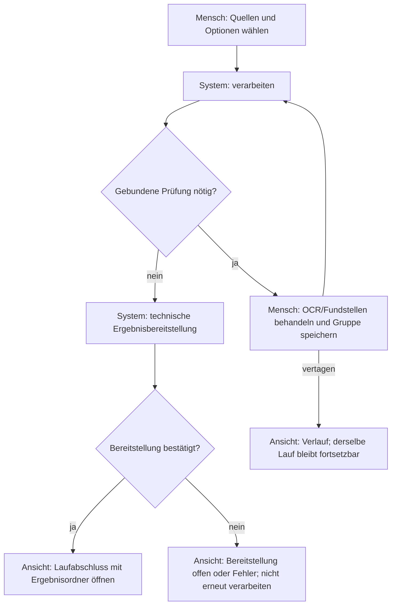
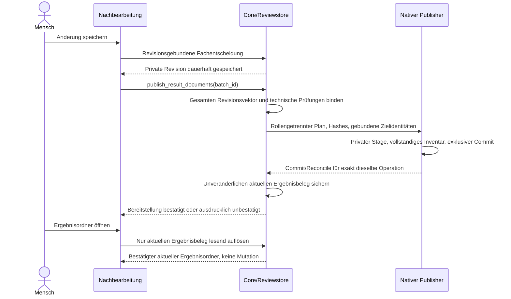

# RC166: direkte Ergebnisbereitstellung

Status: Umsetzung, noch kein neuer Paket-/Release-PASS. Windows-/Mac-Desktoptests
bleiben Nutzer-/Kollegenaufgabe. Keine neue Automation.

## Tatsächliche Zwischenbefunde und enge Korrekturen

- Echter Windows-Negativlauf `datasecure-native-store-z9Pp2p`: neue Defaultwurzel
  hatte Number-Inode70931694135686584; die Legacyadmission verweigerte korrekt.
  Für alle neu gespeicherten Node-Kennungen verwenden /5 und /6 nun zusätzliche
  BigInt-Dezimalstrings einschließlich `birthtime_ns`. Rust vergleicht sie auf
  dem bereits gehaltenen Handle vor jeder nativen Provisionierung. Alte
  gerundete /1-/2-Bindungen werden nicht aufgewertet. /5-/6 bleiben auch bei
  Unerreichbarkeit als Quellenausschluss abgeschirmt. Frisch ausgewählte native
  Ziele erhalten ebenfalls /6 mit exakter Statbindung; Lesen alter /4-Dateien
  nimmt keine neue Identität auf. 17 Konfigurationsgegenfälle
  und ein echter Node→Rust-/5→/6-Test bestanden. Maßgeblich ist Nodes
  [BigInt-Stat-Vertrag](https://nodejs.org/download/release/v22.23.2/docs/api/fs.html#statsbirthtimens).
- Unabhängiger Quellengegenreview: Initialordneröffnung prüfte bisher keine
  Blattänderungen/zusätzlichen Dateien. Neue Initial-Layouts verlangen jetzt
  gespeicherte BigInt-Blattidentitäten, Hashes und geschlossenes rekursives Inventar.
  Fehlende/ersetzte MD oder eine hinzugelegte private CSV sind keine gültige Ausgabe.
- Zweiter Quellengegenreview: Der JS-Initialwriter selbst verwendete historisch
  Number-IDs vor dem Schreiben. Der eng getrennte neue Layoutpfad erhält deshalb
  vor der Mutation exakte Objekt-/Elternbindungen und eine versionierte
  Destination-ID. Eine echte OS-Race-Reproduktion dieses Präzisionsfensters ist
  nicht behauptet; der kausale Quellengegenfall wird separat geprüft.
- Wiederaufnahme-Gegenreview: Vor jedem Directory-/Leaf-Schreibversuch wird
  dauerhaft eine private Versuchsabsicht gesichert. Ein Abbruch vor Erfolgsanker
  bleibt auch nach externer Löschung unsicher; kein zweites Mkdir oder Link.
  Der synchrone Mkdir-/Erstbindungsabschnitt hält den vorhandenen ABI1-Guard am
  ursprünglichen Outputcontainer. Dessen Lockdatei liegt nicht zwischen den MD.
  Keine Rechteänderung, kein Fallback, kein Mac-Core-Neubau. Verweigerung und
  unbestätigtes Schließen bleiben Fehler. Quellen-/RAM- und Recoveryorakel
  sind von der noch ausstehenden paketierten nativen Probe getrennt.
  Dies schützt innerhalb des bestehenden Owner-/ACL-Vertrags gegen andere
  gewöhnliche Konten; es macht Node-Mkdir nicht atomar gegen feindlichen
  Same-UID-/RAM-Austausch. Diese bereits dokumentierte Schutzgrenze des
  nativen Ownershipfundaments bleibt ausdrücklich bestehen.
- Der native Publikationsbefehl erfordert vor und nach RPC denselben aktiven
  Dokumenteditor-Batch; kein beliebiger Verlaufsbatch erhält Schreibautorität.
- Vor dem tatsächlichen Laufabschluss bleibt die Nachbearbeitung lesbar, darf
  aber keine neue private Textrevision speichern. Sonst würde der Fachcommit
  gelingen, bevor die dazu notwendige Ergebnisbereitstellung zulässig ist.
- Neuer P2 aus tatsächlichem Brückengegenreview: Die absichtlich private
  Basiszuordnung passte nicht zum alten „Veröffentlichung fehlgeschlagen“-DTO.
  Ein eigener geschlossener Private-Scope-Zweig öffnet die Zuordnung ohne
  falsche Warnung oder Veröffentlichung. Legacywarnungen bleiben unverändert.
- Echte Windows-Pipe-Komposition mit unveränderter Erstgeneration, zwei aktuellen
  MD, verlorener Antwort, neuer Storeinstanz und verweigerter manueller Änderung
  bestanden. Das ist kein eingefrorener Gesamt-/Paket- oder Desktopnachweis.

Alte Läufe ohne tatsächliche Ergebnisbereitstellungsfähigkeit bleiben lesbar,
aber ohne neue Textmutation in diesem vereinfachten Editor. Vorhandene private
Änderungen und damalige Kopierbelege bleiben erhalten. Kein Fachcommit, der erst
danach unvermeidbar an `RESULT_PUBLICATION_LEGACY` scheitert.

Gezielte Nachweise: Workspace419, Dokumentrenderer156, Präsentation49,
Reviewfrontend67; Browsermatrix mit echtem HTML/JS/CSS und synthetischem IPC
für direkten Ordneröffner, vollständige Nachbearbeitungsbereitstellung,
ausstehende Bereitstellung, gezielte Verlaufslesung, Tastatur/Axe/Reflow grün.
Die Browserumstellung fand vier veraltete Erwartungs-/Vorschaudatenfehler:
neue Ergebnisbeschriftung, automatische Approval-Basis nach Nachbearbeitung,
behaltene Detailklappe und deren explizite Close/Reopen-Neulesung. Sie wurden
im Test-/Vorschauadapter korrigiert, nicht als Produktfehler umetikettiert.
Die rote Async-Guardprobe verlangte ausschließlich den privaten Datenroot;
der RAM-Adapter bildet jetzt zusätzlich exakt den Outputcontainer und getrennte
reentrante Root-Guards ab. Alle51 Asyncprüfungen danach grün; kein nativer PASS.

Eine gemeinsame neue Paketprobe ist für Windows und beide Macs eingebunden:
der echte paketierte Core hält eine separate ABI1-Outputcapability. Der
produktive Initialwriter muss vor Mkdir und Versuchsabsicht mit Busy verweigern;
nach Freigabe schreibt er zwei MD einschließlich Unterordner, und unter erneut
gehaltenem Outputlock bleibt das Wiederöffnen rein lesend. Originalbytes und
Inventar werden verglichen; ungeklärte Handles oder Fehler erhalten die Fixture.
Mac-Probe, ACL-Probe und Participant sind gemeinsam hashgebunden. Gezielte
33 Quellen-/Mac-Vertragsmodelle und 43 Lifecyclemodelle sind grün. Dies ist
noch kein nativer PASS der neu zu bauenden Paketbytes.
Unabhängiger tatsächlicher Quellengegenreview dieser Probe und beider
Einbindungen ohne bestätigten Blocker. Der Helper prüft den Initialwriter im
Paket-Core, nicht die vollständige autonome Processing-Worker-Komposition und
keine Desktop-/Finder-Bedienung. Die erneute echte Windows-Node/Rust-Pipe
(`datasecure-native-store-N3pw9n`) bestand anschließend ebenfalls.

Erster eingefrorener Source03-Gesamtlauf: Headless ROT bei der konkurrierenden
Root-CAS-Fixture. Sie beließ die neue exakte /5-Kennung am alten Root; die
Produktverweigerung war richtig. Zwei weitere statisch gefundene Altschema-
Fixtures wurden mit korrigiert: Sidecar verlangt nun /6-/5 und exakte Identität,
die explizite alte /3-Guardfixture besitzt keine versteckten /5-Felder. Die
ursprünglichen CAS-, Verweigerungs- und Legacyorakel bleiben erhalten, unabhängig
am tatsächlichen Produktionsreader/-writer gegengelesen. Windows-Native Source03
bestand244 Rusttests (3 ignoriert); Mac wurde gezielt abgebrochen. Source03 bleibt
rote Historie, kein neuer Produktfix und kein Ersatz für den frischen Gesamtlauf.

Anschließender echter Source-Sidecar-Gegenfall: terminale Fachzähler wurden vor
dem atomaren Abschluss der Erstbereitstellung sichtbar. Ein gültiger noch
unvollständiger neuer Plan wurde fälschlich als Konflikt beschrieben. Nur nach
vollständiger Schema-/Batch-/Owner-/Contentankerprüfung und nur bei nichtleerem
Plan mit `complete === false` lautet der lesende Status jetzt Pending. Keine
Ordner-/Korrekturautorität, kein Produktionsretry, keine neue Deadline. Fertiger
Plan ohne Flags/Bindung oder mit manipulierten Dateien bleibt Conflict; Legacy
bleibt unverändert. Acht Gegenfälle und echte Source-Sidecar-Komposition prüfen
die Grenze getrennt. Unabhängiger tatsächlicher Quellengegenreview bestätigt
den engen Vertrag. Source-Harness ohne nativen Publisher bleibt kein Nachweis
der neuen nativen Nachkorrekturbereitstellung; Legacyexport wird dort separat
als Kompatibilitätsweg geprüft, nicht als normaler neuer Anwenderablauf.
Danach gezielt bestanden: 32 Generationen-/Pending-Gegenfälle, 86 echte
Root-Dateisystemfälle, 261 native Ownership-CAS-Assertions sowie komplette
Source-Sidecar-/Processing-Worker-Komposition einschließlich OCR an/aus,
Legacy-Kopie und sechs bestätigten Host-/Worker-Abschlüssen. Zudem erneut
51 Async-,15 Initialwriter-,156 Renderer- und49 Präsentationsfälle grün.
Die vollständigen eingefrorenen Source04-Belege müssen diese Vorabtests ersetzen.

## Anwendervertrag

- Quellen auswählen und verarbeiten. OCR bleibt separat; geführte Fundstellen-
  und gewählte OCR-Prüfung bleiben vor dem Abschluss.
- Nach erfolgreicher technischer Bereitstellung: **Ergebnisordner öffnen**.
  Keine zweite Dateiauswahl, Dokumentfreigabe oder Exportbestätigung.
- Optionale Nachbearbeitung: Änderung speichern; die Software stellt den
  vollständigen aktuellen Stand bereit. Ein neuer Ergebnisstand ersetzt keine
  fremden oder außerhalb der App veränderten Dateien. Alte Stände bleiben erhalten.
- Bei fehlender Bestätigung: Änderung gespeichert, Bereitstellung unbestätigt.
  Derselbe Vorgang wird abgeglichen; kein neuer Lauf und keine zweite Kopie.
- Technische Prüfung ist kein Nachweis vollständiger Anonymität. Automatische
  Maskierung wird nicht als menschliche Prüfung oder Freigabe dargestellt.

## Aktivität: normaler Lauf

## Sequenz: optionale Nachbearbeitung

## Technischer Vertrag

Die neue interne Aktion akzeptiert ausschließlich die Laufkennung, keine
Renderer-Dateiauswahl, Zielpfade oder behauptete menschliche Zustimmung.
Die Rolle `publication_role: results` bindet Plan, private Records und nativen
Zielnamen `Ergebnisse-<operation_id>`. Legacyexport ohne Rolle bleibt historisch.
Vollständige neue Generationen verwenden die bestehende native Create-only-
Transaktion: gleicher Datenträger, gehaltene native Handles/Guard, vollständiges
Inventar, gebundene Hashes und Revisionen, exklusives Veröffentlichen und erneute
Prüfung. Neue freigegebene Überschreibrechte sind nicht Teil der Vereinfachung.

Vor erneuter Bereitstellung muss der bisher bestätigte Ergebnisstand noch
unverändert vorhanden sein. Alte schwache Identitäten werden nicht still in
starke native Belege umgedeutet. Read-only Status/History erzeugt keine Dateien.
Mehrfachaufruf/Lost ACK müssen dieselbe Operation rekonstruieren. Ein fehlender
Stage und fehlendes Ziel sind ungewiss, nicht sicher ungeschrieben. Fehler nach
Fachcommit ändern dessen Wahrheit nicht und dürfen keinen Erfolg vortäuschen.

Neue Erstordner enthalten keine Quellnamenzuordnungen oder Identitätsübersichten.
Diese bleiben getrennt privat erreichbar. Alte Laufordner werden nicht bereinigt
und nicht rückwirkend als ausschließlich weiterverwendbare MD beworben.

## Zwingende neue Gegenorakel

1. Geführt, automatisch, OCR an/aus und Markdown: kein zusätzlicher Export nötig.
2. Textkorrektur, Maskierung, Wiederherstellung und runweite Änderung: geöffnete
   Ergebnisbytes entsprechen exakt dem gesamten aktuellen Revisionsvektor.
3. Keine Originale, Zuordnungen, Identitätsdaten, Journale oder Diagnosen im neuen
   fertigen MD-Inventar; keine automatische Veröffentlichung ungespeicherter Texte.
4. Fremddatei, Hardlink/Reparse/Symlink, ersetzte Eltern, Zielwechsel, falscher
   Purpose/Batch/Revision/Hash/Rolle und Quotenüberschreitung werden verweigert.
5. Fehler vor/nach Commit sowie Lost ACK: keine zweite Generation für denselben
   Stand, keine Rückkehr zu einem alten Stand und keine neue Anonymisierung.
6. Manuelle Löschung bleibt gelöscht; History/Start/Ordneröffnen mutieren nicht.
7. Legacyexport/ACK bleibt lesbar, ohne neue Ergebnisautorität zu erhalten.
8. Neue unveränderte Gesamt-/Native-/Paketgates für Windows und beide Mac-Runner;
   echte Finder/TCC/M2-/Desktopabnahme bleibt separat beim Menschen.

## Primärquellen zum erhaltenen Dateisystemvertrag

Microsoft dokumentiert bei [FILE_RENAME_INFO](https://learn.microsoft.com/en-us/windows/win32/api/winbase/ns-winbase-file_rename_info)
die Verweigerung bei vorhandenem Ziel mit `ReplaceIfExists = FALSE`.
Die macOS-Implementierung nutzt `renameatx_np` mit `RENAME_EXCL` aus Apples
[XNU-API-Vertrag](https://github.com/apple-oss-distributions/xnu/blob/main/bsd/man/man2/rename.2)
und den zugehörigen [exklusiven Rename-Gegenfällen](https://github.com/apple-oss-distributions/xnu/blob/main/tests/rename_excl.c).
Keine Umdeutung eines gewöhnlichen überschreibenden Rename in
eine bedingte Ersetzung eigener Dateien. Atomare Veröffentlichung ist keine
pauschale Stromausfallsicherheits- oder Zielhost-Abnahmebehauptung.
