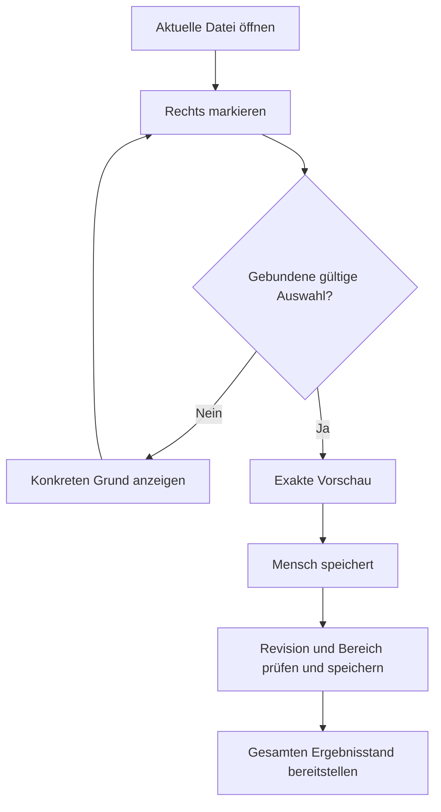
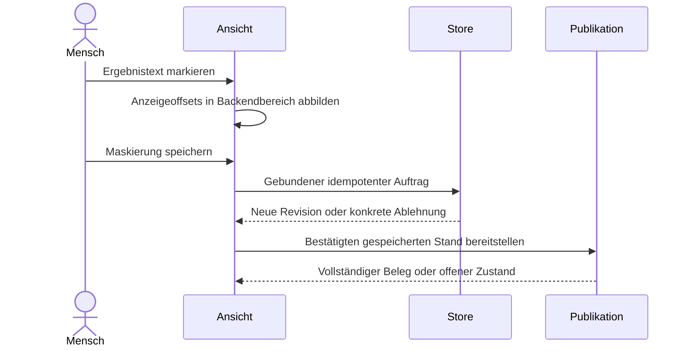
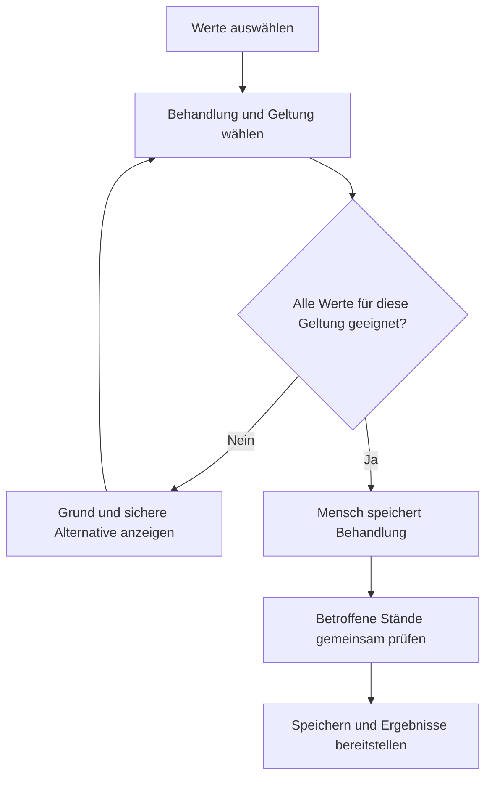
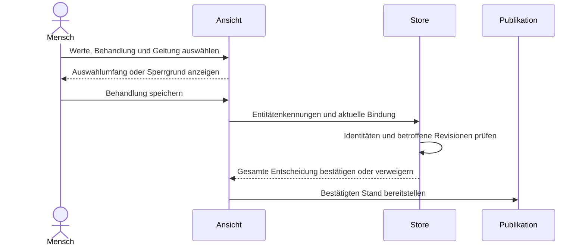
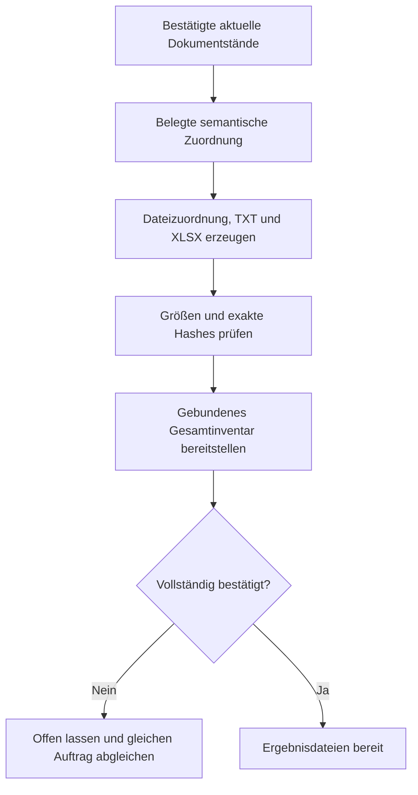
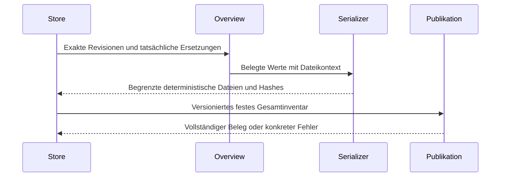

# RC168 – exakte Nachbearbeitung und strukturierte Pseudonym-Zuordnung

Status: Umsetzung und gezielte technische Revalidierung erfolgt;
unabhängige Endreviews/Gesamtregression und neue Paketgates noch offen.
Desktoptests bleiben ausdrücklich bei den Nutzern. RC167 und sämtliche früheren
Pakete, Quellbelege, Nutzerläufe und Ergebnisordner bleiben unverändert.

## Auftrag und Reihenfolge

1. P1 TEXT-POSITIONS-01: Anzeige- und Backendkoordinaten bei CRLF/LF/CR und UTF-16
   sicher abbilden. Bestehende gespeicherte Bytes, Revisionen und Hashes nicht
   nachträglich normalisieren. Maskierung, Entitätenhervorhebung und freiwillige
   Markdown-Nachkorrektur gemeinsam prüfen.
2. REVIEW-ACTIONS-01: aktuelle Lesbarkeit, Mutationsfähigkeit, Markierung,
   Entwurf, Speicherbestätigung und Ergebnisbereitstellung getrennt modellieren.
   Sperrgründe anzeigen, identische UI-/Handlerbedingungen und eindeutige
   Fundstellenseitennavigation; keine neue Freigabe-/Exportpflicht.
3. RESULT-COMPANIONS-02: neue Anonymisierungsstände erhalten exakt
   `Vertraulich/Dateizuordnung.csv`, `Pseudonym-Zuordnung.txt` und
   `Pseudonym-Zuordnung.xlsx`. Keine zusätzliche Pseudonym-CSV als Standard.
   XLSX mit Typ/Basiswert/Endwert je Dokument und nachvollziehbarer Standbindung.
4. Unabhängige begrenzte Quellengegenreviews, neue kausale Gegenfälle,
   Gesamtregression und native Windows-/ARM64-/Intel-Build-/Paketgates aus
   demselben abschließenden Appcommit. Erst dann Testübergabe/Pre-Release.

## Revalidierte technische Grenzen

Textareas verwenden einen normalisierten API-Wert; CRLF-Speicherpositionen sind
nicht unmittelbar Anzeigeoffsets. Die Aufbereitung erhält CR/LF ausdrücklich.
Ein reiner synthetischer Aufbereitungsgegenfall zeigt die abweichenden Bereiche;
kein konkreter Nutzerlauf oder nativer WebView wurde dadurch reproduziert.
Quelle: <https://html.spec.whatwg.org/multipage/form-control-infrastructure.html#textFieldSelection>.

XLSX enthält ausschließlich literale Textzellen, keine Formeln/Makros/externen
Links. Excel-Zellgrenzen einschließlich 32.767 Zeichen und 253 Zeilenumbrüchen
werden verlustfrei behandelt; keine stille Kürzung. Tabellen werden aus der
gebundenen strukturierten Overview erzeugt, nicht aus geparstem Menschen-TXT.
Quellen: <https://learn.microsoft.com/en-us/dotnet/api/documentformat.openxml.spreadsheet.cell?view=openxml-3.0.1>,
<https://support.microsoft.com/en-us/excel/excel-specifications-and-limits>.

Die vorhandenen eigenen statischen Mac-Cores bleiben getrennte gepinnte Rollen
vom offiziellen Konverter. JS/Rust-Publikations- und Darstellungsänderungen
verändern nicht die C-/Adapter-/Transformquellpins des eigenen Coreproducers.
Neue äußere App-/Ressourcenbytes brauchen neue lokale Ad-hoc-Seals und tatsächliche
native Consumerprüfungen. Keine Developer-ID, Notarisierung, Apple-Einreichung,
Storeverteilung oder Lockerung von Gatekeeper, Hardened Runtime oder eigener
Core-Library-Validation. Ad-hoc ist keine Apple-Zertifizierung. Echte Finder-/TCC-/
M2-/Enterprise-/VoiceOver-Zielhosttests bleiben getrennt offen.
Quellen: <https://v2.tauri.app/distribute/sign/macos/>,
<https://support.apple.com/guide/mac-help/open-a-mac-app-from-an-unknown-developer-mh40616/mac>.

## Zustands- und Speichervertrag

- Dokumentbindung: Lauf, Dokument, Revision und Hash; keine Auswahlübertragung
  auf einen anderen Dokumentstand oder eine alte Verbindungsgeneration.
- Markierung ist zunächst nur lokal. Vorschau zeigt die tatsächliche betroffene
  Stelle; eine bewusste Speicherung sendet genau einen Operationsauftrag.
- Laufgeltung nur für belegte gemeinsame Identitäten. Kontakte, mehrdeutige Werte
  und generische Masken erhalten keine erfundene globale Zuordnung.
- Gespeicherte Änderung und bereitgestellter Ergebnisordner sind getrennte
  Zustände. Bei verlorener Antwort gespeicherten Stand abgleichen, nicht blind
  erneut entscheiden. Bei Publikationsfehler denselben Auftrag wiederaufnehmen.
- Ein neuer vollständiger Ergebnisstand bindet Markdown und alle drei
  Pflichtbegleitdateien. Frühere Stände bleiben unverändert.
- Alte /1-/2-Inventare und unterbrochene /2-Aufträge behalten Namen, Rollen,
  Serialisierung und Operationsidentität. Neues /3 ist kein Reparaturlesen.
- Erstwriter bestätigt Vollständigkeit nach einzelnen create-only-Publikationen;
  native Korrekturgenerationen prüfen vor Veröffentlichung einen Stagingordner.
  Diese Atomaritätsgrenzen werden nicht gleichgesetzt.

## Aktivität: zusätzliche Maskierung

## Aktivität: erkannte Werte behandeln

## Aktivität: Zuordnungsdateien

## Noch auszuführen

### Gezielter Zwischenstand, noch keine Paketfreigabe

**Neuer bestätigter P2 vor dem Freeze:** Der unabhängige UI-Gegenreview
reproduzierte eine alte Fundstellenseitenantwort nach Verbindungsinvalidierung
und frischem Öffnen eines Nachfolgelaufs. `changeEntityPage` prüfte den Besitz
im `catch` nicht und konnte dessen `stateFresh`/Status überschreiben; der
`finally`-Check kam erst nach dieser Mutation. Frühere180/419/13Grüns widerlegen
das nicht. Enger Batch-/Connection-/Viewbesitzfix in Catch und Finally umgesetzt;
vier neue Deferred-Gegenfälle (gleicher/anderer Nachfolger, jeweils alte
Erfolgs-/Fehlerantwort) bestanden. Autor184Renderer-/419Workspace-/13Browserfälle
grün. Hauptagent184Renderer-/13Browserfälle frisch bestanden. Unabhängiger
Reviewer wiederholte sein ursprüngliches Gegenorakel auf den neuen Bytes:
4/4grün, tatsächlicher Ergebnisöffner weiterhin ausführbar. Kein verbleibender
Befund im eng geprüften Delta; vollständige Endgates bleiben getrennt erforderlich.

- Positionsadapter:172Renderer-/419Workspace- und10Headless-Browserfälle
  durch den Autor sowie172Rendererfälle und12.593 deterministische gültige
  Bereichsrundläufe durch den Hauptagenten bestanden. Echte HTML-Textareas mit
  synthetischem IPC sind kein nativer Windows-/Mac-WebView-Nachweis.
- Unabhängige Rust-/Store-/Workbookquellengegenreviews abgeschlossen; keine
  bestätigten Deltablocker. Gebundene XLSX-Leser erzeugen oder komprimieren
  den Inhalt nicht erneut; fehlende Dateien werden nicht repariert.
- Finale Nachbearbeitungsoberfläche:180Renderer-/419Workspacefälle durch den
  Autor,180Renderer- und13echte Headless-Edge-Textareafälle durch den
  Hauptagenten bestanden. Echte Mausmarkierung, Tastatur-Select-All, Fokuswechsel,
  mehrseitige Auswahl und verweigerte Mutation nach fehlgeschlagenem Reload
  enthalten. Reine Fundstellenseitennavigation speichert nichts. Der zunächst
  rote Pfeiltastenversuch wurde separat gegen Edge ohne Anwendungscode geprüft;
  dessen readonly-Cursorverhalten ist kein bestätigter Produktfehler.
- Main:20Companion-/34Workbook-/65Generationenfälle und66Async-Checks grün.
  Zusätzliche unabhängige historische initiale `/2`-Gegenfälle erweitern den
  Generationslauf auf67/67: tatsächlicher JS-Erstwriter mit altem Zweirollenplan,
  completed Reads/Worker-No-op mit unveränderten BigInt-Dateiidentitäten,
  kontrolliert unterbrochene MD-Publikation und gleicher alter Wiederanlauf;
  erst echte neue Nachkorrektur erhält `/3`. Modellierter Native-Callback ist
  dabei ausdrücklich kein neuer Rust-/Mac-Nachweis.
- Create-only RC168-Endgate-/Übergabehelfer vorbereitet unter
  `dist/rc168-review-workbook-source01-20261020`;31Negativfälle und119Bindings
  durch Autor und Hauptagent bestanden. Keine alten FINALs übernommen,
  keine Desktop-PASS erfunden. Zusätzliche Browserprobe im11erSupplementalplan;
  Workbooktest in kanonischem Headless-Plan und beiden Mac-Consumern gebunden.
- Tatsächlicher synthetischer Produkt-XLSX-Import und drei gerenderte Blätter
  unter `dist/rc168-workbook-qa-20261020` geprüft. Normale Textwerte, Unicode,
  führende Nullen, Formelpräfixe und Dokumenttrennung bleiben im gelesenen
  Datenmodell erhalten. Der Renderer zeigt die lange Ziffernfolge dennoch in
  Exponentialdarstellung; dies ist kein tatsächlicher Excel-Anzeigepass.
- Spezieller literaler `_x000A_` wird vom Produkt gemäß ST_Xstring als
  `_x005F_x000A_` geschrieben. ArtifactTool und Openpyxl dekodieren diesen
  Inlinewert nicht. Rote Erstprobe und getrennte Importergrenze sind erhalten,
  kein vollständiger Import-PASS. SharedStrings lösen nicht alle Gegenfälle
  und wurden deshalb nicht als unbelegter Workaround eingebaut. Quelle:
  <https://learn.microsoft.com/en-us/openspecs/office_standards/ms-oe376/bd0aa042-434a-4ca7-b25f-4e1fd25a954d>.
  Echte Excel-/Numbers-Anzeige bleibt beim Nutzer zu prüfen; Rohwerte werden
  nicht zur Anpassung an einen fehlerhaften Leser verändert.

Neue gezielte Quell-/Browser-/Nativegegenfälle, unabhängige Revalidierung der
tatsächlichen Deltas, eingefrorene Gesamtregression, Windows-Paket und beide
echten Mac-Consumer, tatsächliche Artefaktprüfung, lokale und Remoteübergabe.
Keine der historischen RC167-PASS-Evidenzen ist bereits eine RC168-Abnahme.
