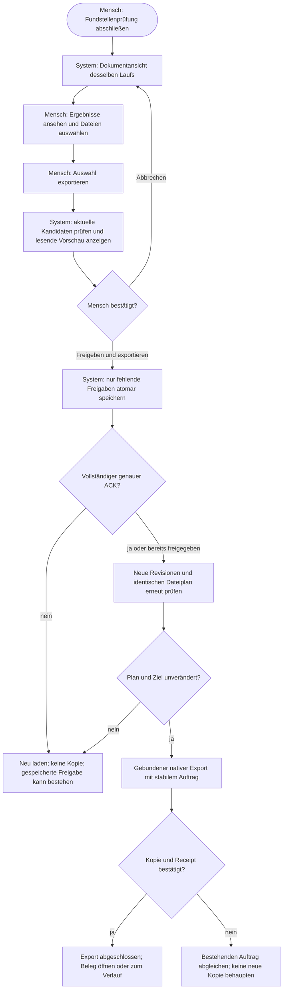
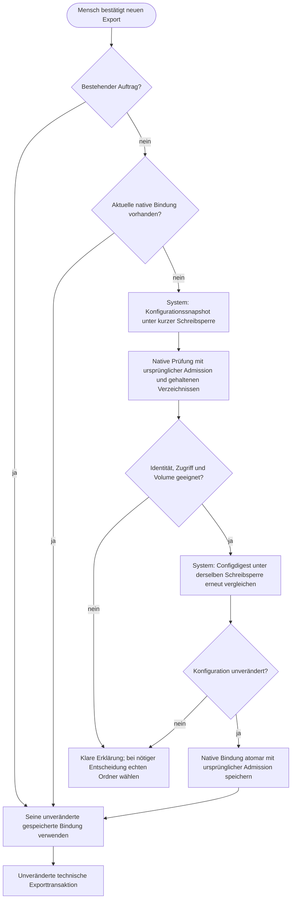
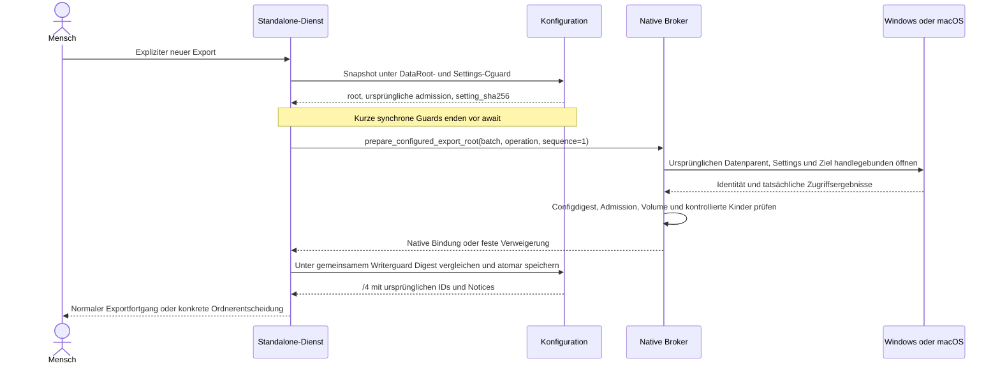
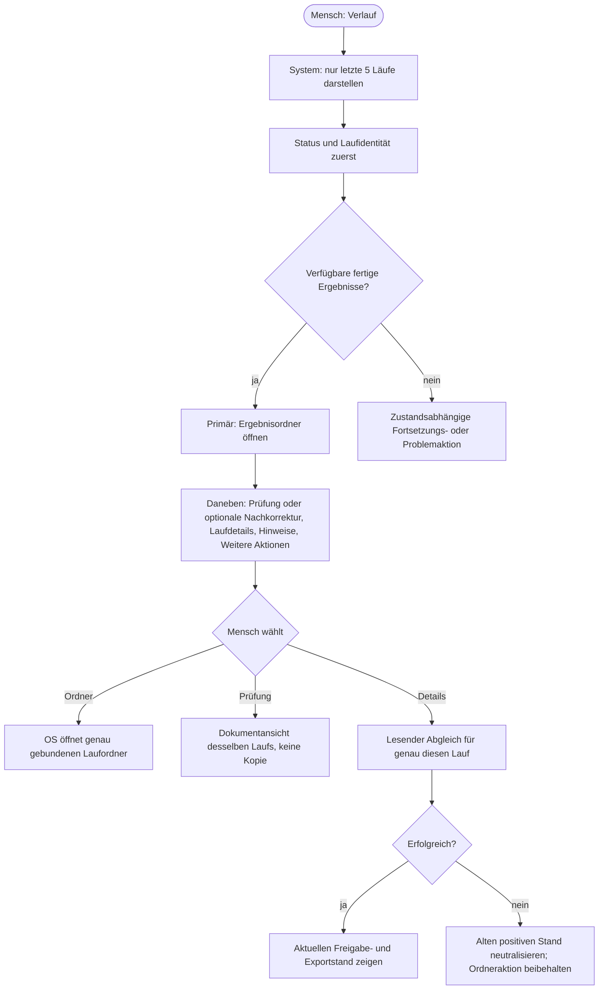
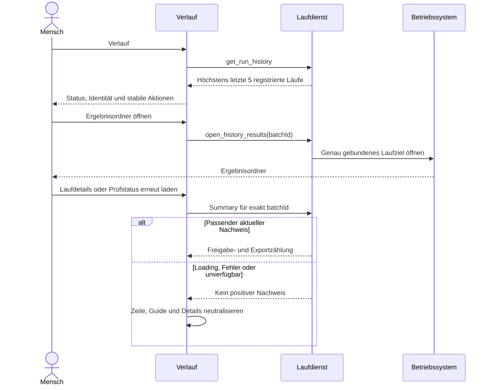
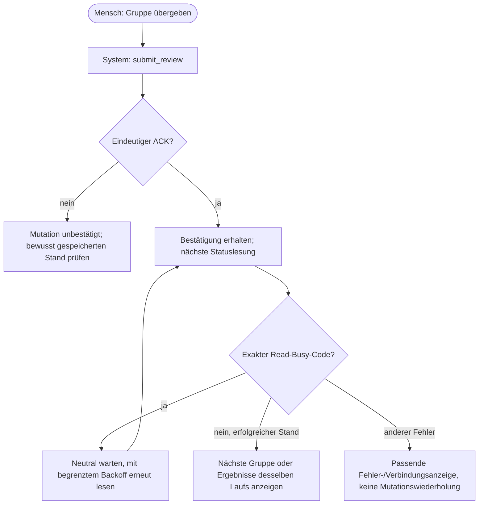

# Standalone nach RC164 – Export, Ordnerbindung und Verlauf

Stand: 19.10.2026. Quellreview/Entwicklungsnachweis, keine Paket- oder Zielhostabnahme.
Auftrag und offene Arbeit ausschließlich in `../canonical/BACKLOG.md`.
Windows und macOS verwenden dieselben Fachmodule, mit nativen OS-Adaptern.
Veröffentlichte RC164-Pakete und ihre eingefrorenen Nachweise bleiben unverändert.

## Ausgangslage und Soll

Die gelieferten Mac-Protokolle belegen einen erfolgreichen Corestart, zunächst
fehlende Exporteinrichtung und danach einen Drei-Dateien-Export samt ACK.
Sie belegen weder einen Coreabsturz noch die konkrete frühere Configversion.
Der zusätzlich überlassene Ergebnisbaum enthält keine private Konfiguration;
ein verlorener nativer Ordnergrant ist daraus nicht rekonstruierbar.

| Hauptfunktion | Bisherige Irritation | Neuer Vertrag |
|---|---|---|
| Dokumentexport | Maskierungen bereits entschieden, danach nochmals Pflichtfreigabe, danach Export | Vorschau ohne Mutation, dann einmal „Freigeben und exportieren“; technische Freigabe bleibt intern |
| Gespeichertes Ziel | Trotz vorgewähltem Ergebnisordner beim ersten Export nochmals Picker | Bei fehlender nativer Bindung ursprünglichen gespeicherten Ort eng prüfen/übernehmen; nur bei notwendiger Entscheidung Picker |
| Verlauf | Ordnerknopf bei Anonymisierung anders positioniert/gewichtet als bei Konvertierung | Verfügbare fertige Ergebnisse: „Ergebnisordner öffnen“ zuerst/grün; Prüfung bzw. optionale Korrektur bleibt direkt erreichbar |
| Status nach Entscheidung | Bereits bestätigte Entscheidung wurde durch belegte Folge-Lesung als unbestätigt bezeichnet | Exakte Busy-Leseantwort neutral verzögert neu lesen; echte Mutationsunsicherheit bleibt erhalten |

Der gesamte Ergebnisordner kann vertrauliche Zuordnungen enthalten. Der separate
Export enthält ausschließlich die ausgewählten Markdown-Dateien. Export ist
nicht gleich Upload und nicht auf KI-Nutzung beschränkt. Originale, relative
Lauf-Unterordner und alte Exportnamen werden nicht umgebaut oder gelöscht.

## 1. Dokumentexport – Aktivität



## Dokumentexport – Sequenz

```mermaid
sequenceDiagram
  actor H as Mensch
  participant UI as Dokumentansicht
  participant S as Dokumentdienst
  participant N as Native Broker
  H->>UI: Dateien auswählen, Auswahl exportieren
  UI->>S: preview_document_export(batch, selection)
  S-->>UI: Namen, Hashes, Zweck, result_folder oder null
  Note over UI,S: Keine neue Freigabe und keine Kopie
  H->>UI: Freigeben und exportieren
  opt Ausgewählte Stände noch nicht freigegeben
    UI->>S: decide_document_review_batch(approve, operation_id, selection)
    S-->>UI: Vollständiger ACK mit neuen Revisionen
  end
  UI->>S: Erneute Vorschau mit bestätigten Revisionen
  S-->>UI: Unveränderter Dateiplan und Zielanzeige
  UI->>S: export_approved_documents(stabile operation_id, selection)
  S->>N: Gebundene Ziel-/Datei-/Hashtransaktion
  N-->>S: Native Publikation und Receipt
  S-->>UI: Exportergebnis
  UI->>S: Derselbe Auftrag, acknowledge=true
  S-->>UI: Dauerhaft bestätigter Beleg
  UI-->>H: Export abgeschlossen; kein weiterer Export nötig
```

Eine Vorschau darf unfreigegebene aktuelle Kandidaten lesen; die tatsächliche
Publikation weiterhin nicht. Im Anonymisierungszweck bleiben Residual-/Policy-
Prüfung auch vor der Freigabe aktiv. Eine Freigabe ist keine fachliche Garantie.
Optionale reine Freigabe/Widerruf stehen eingeklappt unter „Freigaben verwalten“.
Automatische Erstfreigaben werden nicht nochmals manuell freigegeben.

## 2. Gespeicherter Ergebnisordner – Aktivität



## Gespeicherter Ergebnisordner – Sequenz



`result_folder` ist ausschließlich Anzeige, niemals Capability oder vom Renderer
geliefertes Exportziel. `/1` und `/2` verwenden nur verlustfreie ursprüngliche
Node22-Identitäten; `/3` die ursprüngliche native Identität. Unsichere JS-Zahlen,
fehlende/ersetzte Ordner oder abweichende Config werden nicht mit einem frischen
Stat repariert. `/4` und alte Operationen bleiben unverändert. Alle Configwriter
teilen dieselbe kurze native Schreibsperre; der CAS-Vergleich einschließlich
Rename-Retry geschieht innerhalb dieser Sperre. Keine Sperre bleibt über die
asynchrone native Anfrage gehalten. Der NativeGuard bleibt dagegen bis zum Ende
tatsächlicher nativer Arbeit im mutierenden Prozess aktiv.

## 3. Verlauf – Aktivität



## Verlauf – Sequenz



Ausblenden bleibt eine Anzeigepräferenz, kein Datei-/Entscheidungslöschen;
ältere Läufe rücken nicht nach. Datenschutzstopp, laufender Worker und offener
Exportauftrag haben weiterhin Vorrang vor gewöhnlichen Fertig-Aktionen.

## 4. Kurzzeitig belegte Statuslesung – Aktivität



## Kurzzeitig belegte Statuslesung – Sequenz

```mermaid
sequenceDiagram
  actor H as Mensch
  participant UI as Prüfansicht
  participant S as Reviewdienst
  H->>UI: Gruppe übergeben
  UI->>S: submit_review
  S-->>UI: Eindeutiger gebundener ACK
  UI->>S: get_review_session
  S-->>UI: STANDALONE_IPC_BUSY oder Control-Busy
  UI-->>H: Gespeichert; Status wird erneut geladen
  Note over UI,S: Kein zweites submit_review und keine neue Freigabe
  UI->>S: Nach bestehendem begrenztem Backoff erneut lesen
  S-->>UI: Nächster aktueller Stand
  UI-->>H: Passende Seite für denselben Lauf
```

## Gezielter manueller Testplan – Nutzer bedient Windows/Mac

Synthetische vorhandene Testdaten verwenden, nur `EINGABEN` wählen, neuen leeren
Ergebnisunterordner pro Versuch verwenden. Keine echten vertraulichen Dokumente
für Diagnosebelege. Die bestehenden zehn Regressionstestfälle bleiben relevant.

| Fall | Klicks/Schritte | Erwartung |
|---|---|---|
| G1 Geführt | Anonymisierung mit OCR; Fundstellen entscheiden; Ergebnisse auswählen; Auswahl exportieren; Abbrechen | Maskierungen bereits angewendet; keine neue Freigabe/Kopie durch Vorschau oder Abbruch |
| G2 Ein Klick | Dieselben Dateien auswählen; Vorschau; Freigeben und exportieren | Eine bewusste finale Bestätigung, genau ein Export mit ausgewählten Dateien, keine privaten Beigaben |
| G3 Ordner behalten | Vorher Ergebnisordner wählen; ersten Export wie G2 starten; App normal schließen/neustarten; neuer Lauf in denselben Ordner | Keine erneute Ordnerwahl, sofern ursprüngliche Identität/Zugriff passen; Ziel in Vorschau sichtbar |
| G4 Verweigerung | Nur eigenen synthetischen Zielordner bei geschlossener App reversibel umbenennen; Exportversuch | Kein neuer Ersatzordner/erfundener Erfolg; klare neue Ordnerwahl; alte Aufträge nicht umgeleitet; Probe anschließend zurückstellen |
| G5 Schnellweg | Automatischen Lauf erstellen; ausgewählte Ergebnisse exportieren | Automatische Erstfreigabe nicht als manuelle Prüfung bezeichnet; kein automatischer Export, keine doppelte Freigabe |
| G6 Verlauf | Konvertierung und Anonymisierung mit Hinweisen; Verlauf bei breitem und schmalem Fenster | Ergebnisordner zuerst/grün; Prüfung/Korrektur direkt, Detail-/Hinweis-/Mehr-Aktionen konsistent; Hinweise bedeuten nicht laufende Verarbeitung |
| G7 Beleg/Neuladen | Export beenden, schließen, zum Verlauf; Prüfstatus erneut laden | Aktueller Beleg ohne zweiten Export; bei fehlgeschlagenem Abgleich kein alter positiver Freigabe-/Exportstand |
| G8 Vertagen | Ungespeicherte Auswahl vertagen und Neustart; danach gespeicherte Gruppe vertagen/Neustart | Keine blinde Wiederholung, nur gespeicherte Entscheidungen bleiben; richtige Laufidentität und Ansicht |

Mac zusätzlich auf tatsächlichem Zielgerät: ZIP und DMG, Finderstart, erster
Ordnerzugriff unter Documents/Downloads, unveränderte Ordnerwahl nach Neustart,
bewusst verweigerter Zugriff und verständliche Rückmeldung. Kein Abschalten
von Gatekeeper, Hardened Runtime oder Library Validation. Kein Apple-Konto,
Developer-ID-Zertifikat, Notarisierung oder Apple-Einreichung erforderlich als
gewählter Distributionsweg; lokales Ad-hoc-Sealing ist keine externe Signierung.
Erstöffnungswarnungen und organisationsabhängige Blockaden bleiben möglich.

## Quellenreview und bisherige Nachweise

Unabhängige begrenzte KI-Fachreviews am tatsächlichen Produktionscode:
Mac-Dateiidentität/Distribution, Windows-Lebensdauer/Config-CAS und
Architektur/Frontend. Keine zertifizierten Personen oder Garantie vollständiger
Fehlerfreiheit. Die Reviews fanden und schlossen eine Writer-CAS-Lücke, eine
Parent-Re-Adoption und einen alten positiven Zeilenstatus nach Lesefehler.
Eine zu strenge Exportstaging-ACL-Prüfung für die normale Settings-Lesung wurde
entfernt: Die vorhandene Core-Cguard-Prüfung, gehaltene Elternbindung und
Configdigest sichern diesen Lesepfad. Exportstaging-ACLs bleiben unverändert.

Gezielte aktuelle Läufe: 379 Workspace-, 103 Dokumentrenderer-, 62 Dokumentstore-,
58 Reviewfrontend-, 47 Präsentations-, 86 Anwendungsdienst- und 10 neue Config-
Migrationsfälle grün. 14 native Rust-Channeltests grün. Tatsächliche Windows-
Zweiprozessprüfung: 261 Assertions/29 private Fixtures grün; Configwechsel während
Await wird nicht überschrieben, Writer während Commit erhält Guard-Busy.
Native Node/Rust-Exportintegration bereits vorläufig grün, frischer Endlauf noch
erforderlich. Headless-Browser `dist/workflow-usability-design-5ZfpaU`: tatsächliche
HTML/CSS/JS, kombinierter Klick, einmalige Kopie/ACK, Fokus, Axe und Reflow grün;
synthetische IPC, **kein Desktopnachweis**. Ein voriger Browserlauf scheiterte an
veralteter Copy-Regex; kein Produktfix und kein rückwirkend grüner Lauf.

Gesamtregression, Clippy/Rust-Gesamtlauf und neue Paket-/Mac-Nativegates werden
separat dokumentiert. Keine alten FINALs auf neue Quellen umetikettieren.

Erster eingefrorener RC165-Versuch `e00376cf48dc89738844f7af661991761e325a65`
unter `dist/rc165-usability-source-20261019` ist **rot**, Inputs unverändert:
Headless stoppte bei Datei20/280 (`test-root-boundary.js:228`), Native bei Clippy.
Das neue gemeinsame Configwriter-Wrapping richtete Settings zu früh ein, noch
bevor ein ungültiger/überlappender Zielort verweigert wurde. Der Fix prüft vor
Einrichtung und nochmals unter Writerguard mit derselben ursprünglichen
Identität. Lesen nicht vorhandener Notices bleibt ohne Einrichtung; Reset
prüft ebenfalls vor Einrichtung. Kein gelockerter Root-Test. 86 unveränderte/
erweiterte echte Root-Dateisystemfälle und 10 Migrationsfälle danach grün.
Clippy beanstandete separat nur eine äquivalente Ganzzahlvergleichsschreibweise
im neuen Rust-Test; nach Korrektur wieder grün. Frischer gemeinsamer Endlauf
erforderlich, keine rote Evidence umgeschrieben.

Offizielle Referenzen, am 19.10.2026 geprüft:

- [Apple: Zugriff auf Dateien und Ordner](https://support.apple.com/en-euro/guide/mac-help/mchld5a35146/mac): Berechtigung bleibt Benutzer-/OS-Entscheidung, kein Pfad als Zugriffsbeweis.
- [Node 22.23.2 fs Stats](https://nodejs.org/download/release/v22.23.2/docs/api/fs.html#class-fsstats) und [Implementierung der Zeitprojektion](https://raw.githubusercontent.com/nodejs/node/v22.23.2/lib/internal/fs/utils.js): Node-Zahlenprojektion von nativer Identität unterscheiden.
- [Microsoft: BY_HANDLE_FILE_INFORMATION](https://learn.microsoft.com/en-us/windows/win32/api/fileapi/ns-fileapi-by_handle_file_information): Volume/Index und Grenze gegenüber 128-Bit-Identitäten; keine geratene ReFS-Bindung.

### Zweiter eingefrorener Versuch: Testorakel vor neuer gemeinsamer Freigabe

`ca587b25f267437cbc4d6f85eb22264e9da20908`, Fingerprint
`f47596a989afa6337eb5bbb51e00664eeee11cd880472ae5a433749cde9b93d5`/332,
unter `dist/rc165-usability-source02-20261019`: Windows Native/Prepare/Clippy/
232 Rusttests (3 ignoriert)/Release und fünf Paketgates bestanden, Inputs
unverändert. Der Paketkorpus bestand 100/100 Dateien mit unveränderten Originalen.
Das Zwischen-ZIP ist **kein freigegebener Endstand**: Headless stoppte nach
59/280 Dateien bei der erneuten finalen Workerprüfung; alle Szenario-Endprüfungen
und die sechs Host-/sechs Worker-Closebelege waren zuvor erfolgreich.

Die kausale Gegenprüfung am erhaltenen Fixture `datasecure-standalone-ipc-SidKSS`
belegt PID-Reuse: der Worker87484 meldete Exit0 um 11:28:11.172 UTC;
derselben PID wurde um 11:28:56.940 UTC ein fremder Edgeprozess zugeordnet.
Die alte späte `kill(pid, 0)`-Abfrage verwechselte diesen mit dem beendeten
Worker. Kein fremder Prozess beendet, keine rote Evidence oder Fixture gelöscht.
Primärprotokolle/Forensik: `dist/rc165-usability-failure-review-20261019`.

Der reine Testfix bindet die Geburtsidentität im laufenden Worker und verlangt
passende Spawn-/Entry-/Exitbelege. Nur `dead` oder `different` beendet den Join;
`unknown`, Probe-/Lesefehler und die unveränderte Fünfsekundengrenze bleiben hart.
Bei den beobachteten Writerrollen bleibt die vollständige generationsgebundene
Kette bis zum tatsächlichen ChildProcess-Close maßgeblich; eine spätere fremde
PID kann diesen Beleg nicht entwerten. Node dokumentiert Close nach Prozessende
und Schließen der Stdio: [Node22.23.2 ChildProcess](https://nodejs.org/download/release/v22.23.2/docs/api/child_process.html#event-close).
59 Integrityfälle inklusive sechs kausaler Joingegenfälle bestanden; unabhängiges
tatsächliches Quellengegenlesen ohne bestätigten Restblocker. Danach echter
Windows-Sidecarlauf vollständig bestanden: vier Dokumentzwecke, OCR-/Schnellweg,
sieben Ende-/EOF-/Fehlerfälle und exakte sechs Host-/sechs Worker-Closebelege.
Modelle sind keine native Mac-Zielhostabnahme; Gesamtregression folgt frisch.

Mac-Consumer39244694663 scheiterte auf ARM separat im neuen Unix-Test:
Der Test legte selbst `settings.original` neben `settings` an und erwartete
fälschlich nur einen Eintrag. Der native Aufruf war zuvor verweigert und der
öffentliche Root leer. Das korrigierte Testorakel prüft exakte Namen, beide
unveränderten Settingsdateien und fehlende Nonce in Original-/Ersatznamespace.
Unabhängig kausal gegengelesen; keine Produktions-, ACL- oder Sealingänderung.
Intel wurde nach dem bestätigten ARM-Testfehler gezielt abgebrochen, nicht als
grün gewertet. Beide Consumer benötigen neue Läufe am neuen gemeinsamen Commit.

### Fortsetzung nach Nutzerneustart: Standardordner und weiterer Snapshotbereich

Source03/`66f205436361e4800537249be84b7e19340647b2`, Fingerprint
`5f15ade319953ac8a4baaa00a3bc1f92d9496170c2b513bcb01a0bce1f5207f6`/332:
Windows Native/232Rust/Clippy/Release und fünf Paketgates bestanden mit
unveränderten Inputs. Headless wurde beim Nutzerneustart unterbrochen, zuletzt
Datei156/280 gestartet; keine HEADLESS-FINAL und kein Gesamt-PASS. Nicht als
Produktfehler oder grüne Endabnahme umdeuten. Belege und Zwischen-ZIP erhalten.

ARM-Consumer39246795170/118040612738 scheiterte vor Rust beim tatsächlichen
`get_run_failures` im Export-Snapshotleser: `BOUND_FILE_CHANGED` wurde zu
`STANDALONE_HISTORY_UNAVAILABLE`. Exakte historische IO-Phase bleibt unbewiesen;
der Observer zeigte nicht die internen Core-FS-Prüfpunkte. Intel gezielt
abgebrochen, keine Freigabe. Primärlog/Quellengegenreviews erhalten unter
`dist/rc165-source03-failure-review-20261019`.

Unabhängiges Quellengegenlesen identifizierte zwei unvollständig behandelte
legitime Zeitfenster: atomare Publikation nach `open` vor erstem `fstat`, sowie
nach gehaltenem Read vor Postcheck. Der enge Reload verwirft alte Bytes; kein
Erfolg mit einem unlinked FD. Nur dasselbe ursprüngliche gehaltene Objekt mit
unveränderter Größe/mtime, nlink0/1 und anschließend stabilen vollständigen
Statfakten sowie ein anderes stabiles reguläres nlink1-Namensobjekt erzeugt
interne per-call Wiederholungsbefugnis. Ursprüngliche Parentbindung und maximal
drei Gesamtversuche bleiben; neue Bytes brauchen vollständigen Read und
unveränderte Schema-/Owner-/Purpose-/Ankerprüfung. Access-/Read-/Close-/Parent-
und normale Inplacefehler bleiben hart. Strikte Record-/Hashpfade unverändert.
26 Bound-I/O-Fälle einschließlich fünf ausdrücklich modellierter FD-Gegenfälle
und 22 unveränderte/erweiterte Snapshotnegative bestanden unter Windows.
Der echte Produktionspublisher läuft mit drei Phasen auf POSIX; Windows weist
die beiden held-FD-Phasen ehrlich als PLATFORM_NOT_RUN aus (Sharingregeln).
Das ist kein Ersatz für den neuen nativen Mac-Lauf und kein nachträglicher
Beweis des alten CI-Timings.

Die neue Nutzerhypothese zum Defaultordner ist am RC164-Quellcode bestätigt:
`ensureResultRoot()` legt Documents/SecureDataMsg an und speichert /2 mit
Node-Identität, aber ohne `native_export`. Der native RC164-Erstexport benötigt
/4; manuelle Ordnerwahl provisioniert sie. Der Pfad war also nicht einfach
vergessen, sondern die Exporteinrichtung fehlte. Die konkrete alte Einstellung
des Kollegen bleibt als individueller Beweis nicht vorhanden. Kein spezifisches
Apple-Zertifikatsproblem; der Anwendungszustand betrifft Windows und Mac.

Zusätzlicher echter Node/Rust-Test bestanden: Produktionsmethode erzeugt zuvor
fehlenden Default, speichert /2, geht beim expliziten Erstexport über die reale
Servicevorbereitung und den privaten nativen Kanal zu /4 über, ohne Picker.
Identität/Ort und exakte Exportbytes geprüft; neue Service-/Storeinstanz bei
zurückgesetzter flüchtiger Bindung liest denselben Ort, ACK erzeugt keine zweite
Bindung/Kopie. Dies ist ein nativer Windows-Pipe-Nachweis, kein Tauri-GUI- oder
echter Prozessneustart-/Mac-TCC-Nachweis. Neuer gemeinsamer Endlauf erforderlich.
